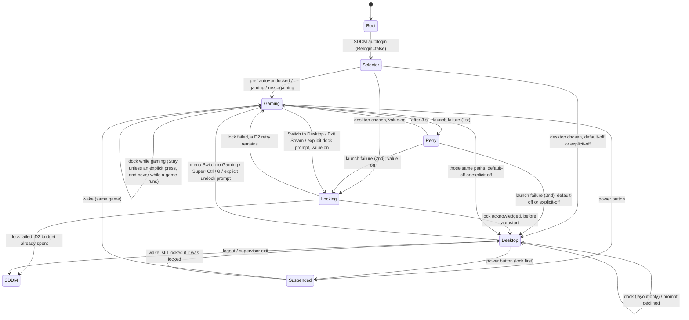

# 02 · Mode switch (gaming ⇄ desktop) and dock / undock

Status: draft for dev-lead review, revision 2, 12 November 2026. Revision 1 followed the red-team review. Revision 2 sets the handheld `desktop-lock` default. Device: ROG Ally RC71L (lid-less, s2idle only). Builds on [01 · Controller and button map](01-controller-button-map.md).
Out of scope: lock-screen / greeter design (AUTH). Where this spec touches authentication it states the requirement and names what is handed to AUTH. It does not design the lock screen.

## 0. Decisions in one table

| # | Decision | Source |
|---|---|---|
| D1 | Handheld variant **autologins straight into the gaming session** by default. | Daniel, 12 Nov 2026 |
| D2 | If gaming fails to launch: **1 automatic retry**, then fall back to desktop with a notification explaining why and a one-tap way back. No loops. That desktop start still passes through the lock choke point (D10). | Daniel + baseline recovery latch |
| D3 | Sessions stay **separate logins** (Gamescope scope ⇄ UWSM Hyprland), as built on `feat/ally-session-20261111`. Nothing running survives a switch except Steam data and system state. | Baseline |
| D4 | Gaming → desktop: **Steam Power → Switch to Desktop** (primary). Desktop → gaming: **AC tap → Omarchy menu → Switch to Gaming** (first item on RC71L), `Super + Ctrl + G`, or the Omarchy Gaming app. AC double tap rejected. | §3 |
| D5 | Dock = external display stable for 3 s. While the session is gaming, dock **never auto-switches**; the prompt defaults to Stay and only an explicit press switches. A game starting dismisses the prompt. Controller input is ignored for 500 ms after the prompt appears. Desktop undock has no countdown. Prompts are rate-limited per display EDID. Resume waits 10 s before any dock prompt. | §5, red review B |
| D6 | New preference value `auto` (default on the handheld variant): undocked ⇒ gaming, docked ⇒ desktop. Users can pin `gaming` / `desktop`. | §6 |
| D7 | Every session or profile switch emits explicit key-ups for every held key, button and trigger before the change. Any component that sees an unknown mode falls back to a safe known mode. | Red review C + lessons from 01 |
| D8 | The switch also swaps the InputPlumber **target and profile**: gaming = `gaming` profile on a **Steam Deck (`deck-uhid`) or DualSense Edge** target (native QAM button, paddles); desktop = `desktop` profile (mouse + keyboard only). Those profile and target names are new (Δ). Today's CLI words are `gamepad` and `dualsense`. Steam starts only after the new target reports ready. If it does not, fall back to `gamepad` atomically. Held inputs are released *before* the swap. | Research final, 12 Nov, plus red review C |
| D9 | No switch or system action is hold-only. Every path has a menu route; Armoury (right) is the only button with a real long press (`F17`); Command Centre (left) long is firmware Ctrl+Alt+Del and is not used here. | Research final + accessibility |
| D10 | **Desktop lock on entry**, one choke point. Every entry into the Hyprland desktop from an autologged-in session goes through `desktop()` in `bin/omarchy-session-start`. When the effective value is `on`, the lock is engaged there, before `uwsm start` shows a frame and before autostart runs. If the lock does not come up and a D2 retry remains, log out back to gaming; if the D2 budget is already spent, exit to SDDM and do not start gaming again. The handheld variant is `omarchy-hw-rog-ally` and the `omarchy-gaming-session` package together. Only that pair ships `default-off`, and only while the root-owned K07 marker is absent. A laptop with the package alone stays `on`. Once the marker exists, a missing, corrupt, or unknown value means `on`, never `default-off`. `default-off` is not `explicit-off`. A one-time migration after K07 sets `default-off` to `on` and leaves `explicit-off` alone. The marker is `/var/lib/omarchy/handheld/k07-landed`, `root:root` mode `0644`, in `/var/lib/omarchy/handheld`, which is `0700` and `root:root`. A downgrade does not remove it, so `default-off` cannot be armed again. If reading that marker fails (permission, I/O, or an odd mount), the check treats it as present, so `desktop-lock` is `on`. Root-owned. Turning it off requires an interactive password prompt, never a passwordless polkit rule. Turning it on needs no auth. Desktop → gaming does not lock. No new lock UI. | Lead, revision 2; follow-up after the pass review |

## 1. Baseline: what is already built

There is no git ref named `feat/ally-session`. The session branch is `feat/ally-session-20261111`.

| Piece | Path | Behaviour today |
|---|---|---|
| Session supervisor | `bin/omarchy-session-start` (`feat/ally-session-20261111`, also on `feat/ally-parity-release-20261111`) | Pre-UWSM entry. Loop: run Gamescope in scope `omarchy-gamescope-$XDG_SESSION_ID.scope` or `uwsm start -g -1 -e -D Hyprland hyprland.desktop`. The ready FIFO must read `started` within 60 s. Failure ⇒ desktop + recovery latch file `recovery` under the state dir. No autologin in this code. |
| SDDM entries | `default/gaming/wayland-sessions/omarchy-gamescope.desktop` (“Omarchy Gaming”), `omarchy-handheld.desktop` (“Omarchy (session preference)”) | Built session is password login. Spec 02 supersedes that policy (D1). Unchanged `default/wayland-sessions/omarchy.desktop` (“Omarchy (Hyprland uwsm)”) is the recovery entry. |
| Preferences | `bin/omarchy-setup-gaming-session`, `default/gaming/session.sh` | `default gaming\|desktop\|last`, `next gaming\|desktop\|clear` (one-shot), `status`, `reset`, `display …`, `overlay on\|off`. Unknown value ⇒ desktop. State in `${XDG_STATE_HOME:-$HOME/.local/state}/omarchy/gaming-session/`. |
| Desktop → gaming | `bin/omarchy-launch-gaming-session` (session branch). `default/gaming/switch.sh` exists only on `feat/ally-parity-release-20261111` | Launcher refuses unless runtime `active` is `desktop`, if `steam` is running, or if `gamescope`/`steam` is missing. Stops wvkbd with `omarchy-toggle-desktop-keyboard stop`. Writes the line `gaming` into `$XDG_RUNTIME_DIR/omarchy-gaming-$session/switch`. The session launcher runs `omarchy-system logout`; `bin/omarchy-system` re-execs that with `--execute`. Release `switch.sh` calls `omarchy-system logout --execute` itself. The launcher accepts no arguments today; `--confirm` is proposed. |
| Gaming → desktop | `default/gaming/bin/steamos-session-select` (private PATH shim, accepts only `plasma`), `bin/omarchy-launch-gaming-desktop` | Writes the line `desktop` to the FIFO `$XDG_RUNTIME_DIR/omarchy-gaming-$session/return`. Exit Steam also returns to desktop. |
| Steam launch | `bin/omarchy-gaming-steam` | `steam -steamos3 -steampal -steamdeck -gamepadui`; starts `omarchy-launch-gaming-powerbutton` when that helper, the `omarchy-rog-ally-powerbutton` package and `/usr/bin/steamos-powerbuttond` are present. |
| Input on entry | `bin/omarchy-session-start` calls `omarchy-hw-rog-ally-input gamepad` when `omarchy-pkg-present omarchy-rog-ally-input` | The binary is on `feat/ally-input-20261111` and the release branch, not on the session branch. Today's arguments are `status\|desktop\|gamepad\|dualsense\|toggle\|capabilities\|intercept\|watch`. There is no `gaming` argument. Non-zero aborts gaming entry. The desktop bridge is not run in gaming; it restores `desktop` when Hyprland starts. `dualsense` is today's DS5 Edge mode. |
| Display | `bin/omarchy-display-rog-ally` (`feat/ally-display-20261111`) | `gaming-output auto\|internal\|OUTPUT` (EDID SHA256, stored as `edid:` + 64 hex), `gamescope-args` → `--prefer-output`; `dock OUTPUT` / `handheld` desktop layouts. Gamescope handles its own hotplug; desktop uses Omarchy’s monitor watcher (`omarchy-hw-recover-internal-monitor`). |
| Power button | `bin/omarchy-system-power-button`, `bin/omarchy-launch-gaming-powerbutton` (`feat/ally-reliability-20261111`) | Desktop: `omarchy-system-sleep-lock`, then `systemctl suspend`. Gaming: Valve `steamos-powerbuttond` inside the scope. The helper does not run the desktop lock flow. |
| Menu | `default/omarchy/omarchy-menu.jsonc` (release branch) | `setup.rog-ally` “ROG Ally Handheld” (`when: omarchy-hw-rog-ally`, action `omarchy-setup-rog-ally`), `setup.gaming` (action `omarchy-setup-gaming`). No root-level switch entry yet. |

## 2. How others do it

| | SteamOS | Bazzite (Deck images) | CachyOS Handheld | Omarchy (this spec) |
|---|---|---|---|---|
| Boot | SDDM autologin into Gaming Mode | Autologin into Steam Gaming Mode | Autologin into Gamescope session | Autologin into gaming (D1) |
| Sessions | Separate: Gamescope ⇄ Plasma ([explainer](https://steamcommunity.com/app/221410/discussions/0/803471225741509907/)) | Separate ([Gaming Mode](https://docs.bazzite.gg/Handheld_and_HTPC_edition/Steam_Gaming_Mode/)) | Separate, Plasma desktop ([handheld guide](https://wiki.cachyos.org/installation/installation_handheld/)) | Separate (D3) |
| To desktop | Steam → Power → Switch to Desktop | Same | Same | Same (shim) |
| To gaming | “Return to Gaming Mode” desktop shortcut | Same | Same | Menu item, bind, app, undock prompt |
| Default persistence | `steamos-session-select plasma-wayland-persistent` / `gamescope` ([GamingOnLinux](https://www.gamingonlinux.com/guides/view/how-to-get-steamos-to-always-boot-into-desktop-mode/)) | SDDM `[Autologin] Session=` ([thread](https://www.answeroverflow.com/m/1334405906246537236)) | `/etc/sddm.conf.d/zz-zoverrides.conf` ([forum](https://discuss.cachyos.org/t/how-to-avoid-steamos-autologin/23162)) | `omarchy-setup-gaming-session default …` (user state, no SDDM edits) |
| Dock auto-switch | None documented (Gaming Mode on TV) | None documented | None documented | Prompt, explicit only, default Stay (D5) |
| Failure loop guard | Session wrapper restarts | Restart/relogin | Restart/relogin | Max 1 retry then desktop + latch (D2) |

Lessons taken: keep Steam’s own Switch to Desktop (muscle memory, no Steam patching); avoid SDDM relogin loops; don’t copy CachyOS’s install script that guesses the autologin user (`plans/rog-ally-parity.md`).

## 3. One-press switch: options evaluated

| Option | Gaming → desktop | Desktop → gaming | Verdict |
|---|---|---|---|
| AC double tap | Needs a listener in gaming; the bridge does not run there, AC tap is Steam QAM, and InputPlumber has no double-tap primitive | Delays every AC tap (Omarchy menu) by 250 ms | **Rejected as default**; if ever added it is a shortcut only, never the sole path (closes spec 01 OQ-6) |
| Steam menu entry (Power → Switch to Desktop) | Native, reached with CC tap; already wired through the shim | n/a | **Primary, gaming → desktop** |
| Omarchy menu entry | n/a | AC tap → first item “Switch to Gaming” → confirm (3 presses, no stick) | **Primary, desktop → gaming** (Δ new root entry) |
| Keyboard bind | n/a | `Super + Ctrl + G` | **Secondary, docked keyboard.** Free in this repo: see OQ-6 |
| Omarchy Gaming app | n/a | Exists (`default/gaming/applications/Omarchy Gaming.desktop`, `Name=Omarchy Gaming`) | Keep |
| QAM item | Needs Decky plugin | n/a | Optional later (Decky is optional on the release branch) |
| AC long (right, `F17`) | 01 Δ3 / research (screenshot vs Omarchy overlay, pending 01 revision) | Controller-profile toggle (01 baseline) | Not used for sessions (D9: hold-only) |
| CC long (left, Ctrl+Alt+Del) | OSK | wvkbd | Not used for sessions |

Proposed root menu item (RC71L-gated, first position). `--confirm` is new; the current launcher rejects any argument:
```jsonc
"switch-gaming": {"icon":"","label":"Switch to Gaming","description":"Close desktop apps and start Steam Gaming Mode",
  "when":"omarchy-hw-rog-ally && omarchy-cmd-present omarchy-launch-gaming-session","action":"omarchy-launch-gaming-session --confirm"}
```

## 4. Confirmation UX and state survival

### 4.1 Desktop → gaming confirmation (Omarchy-styled)

Rendered with `omarchy-menu-select` (same walker/shell styling and theme as every Omarchy picker); controller: D-pad, Y/A select, B/Start cancel.

| Situation | Title | Rows | Default focus |
|---|---|---|---|
| No user windows, Steam not running | Switch to Gaming | Switch now · Cancel | Switch now |
| User windows open | Switch to Gaming? N apps will close | Switch now (apps close) · Cancel | **Cancel** |
| Steam running in desktop | Steam is open | Exit Steam and switch (Δ) · Cancel | Cancel |
| Game running in desktop (Steam child) | A game is running | Cancel only, “Quit the game first” | Cancel |

Δ “Exit Steam and switch”: baseline refuses when Steam runs. Proposed: `steam -shutdown`, wait ≤ 30 s for exit (event: process exit, no polling), then switch; on timeout show “Steam did not exit” and stay.

### 4.2 Gaming → desktop

Steam’s Power → Switch to Desktop. Whether Steam itself warns about a running game is **unverified** (OQ-5). The shim must not stop the scope silently. `omarchy-launch-gaming-desktop` does not write `desktop` to the return FIFO while a game is detected, and does not write it when detection is uncertain, until the user has confirmed. On confirm, the supervisor stops the scope as today (games end; Steam saves cloud data on exit as usual).

### 4.3 What survives a switch

| State | Survives? | Notes |
|---|---|---|
| Running game | **No** | Separate sessions; scope stop ends it. Hence D5 and the “game running” rows above. |
| Steam client | Restarts | Downloads resume next start. Library, saves, prefixes untouched. |
| Desktop windows | **No** | Logout closes them. Omarchy does not restore sessions. |
| wvkbd | Stopped | `omarchy-toggle-desktop-keyboard stop` before logout (baseline). |
| Audio default device / volume | Yes | WirePlumber state is per user. Bluetooth headset reconnect: verify (OQ-8). |
| Brightness | Yes | Backlight sysfs. |
| Display layout | Per session | Desktop: Omarchy monitor profiles. Gaming: `gaming-output` preference. |
| TDP / perf profile | Per session | Gaming starts/stops POWER services it acquired; desktop uses power-profiles. |
| Controller profile / target | Reset | After explicit key-ups and a ready signal (D8, §8). Fallback `gamepad` (Xbox Elite) is atomic. Desktop start: bridge loads `desktop` only once the lock is acknowledged (D10). While the lock is up the bridge stays on `gamepad` (no desktop pointer); that unlock route is handed to AUTH (§7.6). |
| Held keys / buttons | **Released** | Explicit key-ups (D7); see §8. |
| Notifications | No | Desktop notification history only. |
| Dock-prompt “don’t ask” for a display | Yes | Stored by EDID hash in state dir. |

## 5. Dock / undock

### 5.1 Signals

| Signal | Source | Use |
|---|---|---|
| External display connected with valid EDID | DRM connector udev `change`; Hyprland `monitor.added/removed` in desktop | **Primary**: docked ⇔ ≥ 1 external display. Identity is the EDID SHA256 already used by `omarchy-display-rog-ally` (`edid:` + 64 hex), not the connector name |
| USB-C power online | `power_supply` udev | Hint only (shown in prompt text) |
| External keyboard/mouse | input udev add | Hint only; does not change the prompt default |
| Dock USB hub ID | USB udev | Not used (docks vary) |
| Lid | n/a | RC71L has no lid; Omarchy lid binds are inert |

Debounce: the external display must stay connected **3 s** before it counts as docked (cables, HDMI handshakes, monitor sleep). That debounce does not switch session by itself. After resume from s2idle, wait a further **10 s** before any dock prompt (TV HDMI handshakes often outlast 3 s). Monitor power-save (DPMS) on the external screen must not read as undock (OQ-3). Rate limit: at most one prompt per EDID hash until that display has been disconnected for 30 s.

Listeners (event-driven, no polling): desktop = Hyprland Lua `hl.on("monitor.added"/"monitor.removed")` calling `omarchy-handheld-dock event`; gaming = small udev-monitor helper started inside the gaming scope like the power-button helper (owned PID, stopped with the scope) (OQ-2).

### 5.2 Behaviour matrix

| Session | Event | Game running? | Action |
|---|---|---|---|
| Gaming | Dock | No | Prompt “Docked — switch to Desktop?” Default **Stay**. No countdown and no auto-switch. Switch only on an explicit press. B or no input = Stay. Ignore controller input for the first 500 ms. Switch is not on the game’s confirm button (A / South) |
| Gaming | Dock | Yes | Game continues; Gamescope follows `gaming-output` (default auto). **No prompt** and no session change. If a prompt is already up and a game is then positively detected, dismiss the prompt. Uncertain detection never counts as “no game” for a switch |
| Gaming | Undock | any | Gamescope moves to internal panel; no prompt |
| Gaming | Display hotplug / flap mid-game | Yes | Ignored by this spec (debounced; Gamescope handles); never pauses or kills the game |
| Desktop | Undock | n/a | Internal panel restored (`omarchy-hw-recover-internal-monitor`). Prompt “Undocked — switch to Gaming?” Default **Stay**. No countdown, including when no user windows are open (background work is not windows) |
| Desktop | Dock | n/a | Apply the saved layout with `omarchy-display-rog-ally dock <OUTPUT>` when one is saved; no session change |
| Either | Suspend while a dock prompt is up | — | Dismiss the prompt with no action. That is Stay. Do not confirm Switch on the way down |
| Either | Sleep while docked/undocked, wake in other state | — | Wake into the same session and game. The dismissed prompt does not return. A new prompt only after the 10 s resume grace, then the 3 s debounce, and only inside the per-EDID rate limit. Never auto-switch |
| Either | Pinned mode (§6) | — | No dock prompts |

Prompt in gaming is a small controller-navigable client inside Gamescope (Omarchy theme colours, Omarchy font), because desktop layer-shell surfaces cannot appear there. Whether Gamescope gives it focus over Steam is **unverified** (OQ-1); fallback is no prompt: the user uses Switch to Desktop.

## 6. Preferences, pin and override

| Setting | Values | Default (handheld variant) | Δ vs baseline |
|---|---|---|---|
| `default` | `auto` · `gaming` · `desktop` · `last` | **`auto`** | Δ add `auto` (dock-aware at login) |
| `next` | `gaming` · `desktop` · `clear` | — | Keep (one-shot) |
| `dock-prompt` | `on` · `off` | `on` | Δ new |
| per-display “Don’t ask for this display” | EDID hash list | empty | Δ new (reuses DISPLAY EDID hashing) |
| Pin from UI | Omarchy menu → ROG Ally Handheld → Session → Always Gaming / Always Desktop / Auto | — | Δ menu rows over existing CLI |
| `desktop-lock` | `on` · `default-off` · `explicit-off` | Handheld, until K07: **`default-off`**. Other variants: **`on`**. After the K07 migration, handheld too, unless `explicit-off` | Δ new. Root-owned. Not stored under `~/.local/state`. `off` needs an interactive password prompt. `on` needs no auth. See §7.4 |

`omarchy-setup-gaming-session desktop-lock on|off` is the command. `off` stores `explicit-off`, never `default-off`, and only after an interactive password prompt (sudo or polkit that asks for the password). A passwordless polkit rule, including `allow_active` for the already-autologged-in session, must not be able to turn it off. `on` needs no password: the user, the installer, and the K07 migration may set it. Only the handheld installer writes `default-off`, and only while the K07 marker in §7.4 is absent. A process running as the user (Steam browser, a Proton file dialogue, a non-Steam shortcut) cannot write any of these values. `auto` at login: docked ⇒ desktop, else gaming. Unknown/corrupt session preference ⇒ treated as `auto` on the handheld variant, with a desktop notification “Session preference reset” the next time the desktop opens (D7). Before that marker exists, a missing, corrupt, or unknown `desktop-lock` on the handheld variant is `default-off`, not `explicit-off`. Once the marker exists, the same missing, corrupt, or unknown value is `on`. Any other machine, including a laptop that only has the package, treats a missing or unknown value as `on`.

## 7. Boot, autologin and fallback

### 7.1 Autologin (D1)

| Item | Spec |
|---|---|
| SDDM | `[Autologin] User=<installer-created user> Session=omarchy-handheld.desktop Relogin=false` written once by the handheld installer (spec 03), never guessed at runtime. |
| Session | `omarchy-session-start` applies `default`/`next`/latch/dock (`auto`). |
| Relogin | `false`: retries are owned by the supervisor, not SDDM, so a crash cannot loop. |
| Getty | No getty autologin is added. A TTY still requires a password. A session switch does not leave a desktop session on another VT. |
| Desktop reached from autologin | Always through the choke point in §7.4 (OQ-4 resolved). Locked only when the effective value is `on`. |

### 7.2 Failure detection, retry and fallback (D2)

| Failure class | Detected by (baseline unless Δ) | Retry? |
|---|---|---|
| Missing gamescope/steam | `run_gaming` precheck | No (permanent) |
| Input profile load failed | Proposed `gaming` load ≠ 0, then atomic `gamepad` fallback also ≠ 0 | Yes, only if `gamepad` also fails |
| Gamescope exits before Steam child | supervisor `wait -n` | Yes |
| Steam child not acked within 60 s | ready FIFO does not read `started` | Yes |
| Steam exits non-zero within 120 s of start (Δ) | `steam-exit` file + start time | Yes |
| Invalid display settings | `gaming_display_args` | No (permanent) |
| DRM device not ready at boot (Δ) | `gamescope --backend drm` early exit within 5 s of login | Yes, after waiting for `/dev/dri/card*` udev settle (event, ≤ 10 s) |

| Rule | Value |
|---|---|
| Automatic retries per login | **1** (total 2 attempts), 3 s apart |
| After final failure | Start desktop through §7.4; write recovery latch (baseline) with failure class |
| Latch effect | Next autologins go to desktop until an explicit gaming choice clears it (baseline). That desktop start uses §7.4 |
| Steam exit later in a healthy session (> 120 s) | Not a failure: return to desktop normally, no latch. That desktop start uses §7.4 |

Desktop notification after fallback (Omarchy notification, `omarchy-notification-send -u critical`, action via `--action`):

| Field | Content |
|---|---|
| Title | Gaming Mode didn’t start |
| Body | One line from the failure class, e.g. “Steam didn’t open within 60 s (tried twice).” + “Log: ~/.local/state/omarchy/gaming-session/session.log” |
| Action (tap / `Super + ,`, which is `SUPER + comma` → `notifications.act`) | **Try Gaming again** → `omarchy-launch-gaming-session --confirm` (clears latch on success) |
| Also | Omarchy menu → ROG Ally Handheld → Session → Diagnostics opens the log in the Omarchy editor |

The notification is a desktop client. When §7.4 engages the lock, the notification appears only after the lock is acknowledged. When the effective value is `default-off` or `explicit-off`, it appears with the desktop.

### 7.3 Boot races to handle

| Race | Required behaviour |
|---|---|
| Autologin before InputPlumber is ready | `omarchy-hw-rog-ally-input` waits for the composite device on D-Bus (≤ 10 s, signal-driven); else continue with firmware xpad + notify later in desktop |
| Gamescope before amdgpu/DRM | See failure table (Δ udev settle) |
| Dock connected at power-on | `auto` reads DRM connectors before choosing (≤ 3 s debounce). A docked boot that selects desktop uses §7.4 |
| Desktop bridge before lock acknowledgement | When the lock runs, the bridge stays on `gamepad` until the lock is acknowledged, then loads `desktop`. It does not inject a pointer into the lock. When the effective value is `default-off` or `explicit-off`, the bridge loads `desktop` with the session |
| Network not up | Steam offline mode; not a failure |

### 7.4 Desktop lock on entry (D10)

One choke point: `desktop()` in `bin/omarchy-session-start`, before `uwsm start -g -1 -e -D Hyprland hyprland.desktop`. Every path that reaches the desktop from an autologged-in session uses that function and no other lock call. The paths are: the D2 fallback after two attempts, a later boot with the recovery latch set, `auto` with a dock connected at power-on, `default desktop` / `last` / `next=desktop`, an accepted dock or undock prompt, Steam Power → Switch to Desktop, Exit Steam, a Steam crash, and a Gamescope crash.

The lock engaged there, when it is engaged, is the lock-on-resume mechanism dev-blue is building on `feat/ally-session-20261111`. This spec does not define a second implementation. `omarchy-system-sleep-lock` remains the desktop power-button path (lock, then suspend) and is not copied into the supervisor.

The root-owned value is one of three, and `default-off` is stored separately from `explicit-off`:

| Stored value | Who writes it | Effective lock |
|---|---|---|
| `on` | Other variants, by default. A user, with no password. The K07 migration, from `default-off` only. New handheld installs once the K07 marker exists. A missing, corrupt, or unknown value once that marker exists | Engage the lock |
| `default-off` | The handheld installer, and only while the K07 marker is absent. Not a user choice | Skip the lock |
| `explicit-off` | A user choosing `off`, and only after an interactive password prompt. Never a passwordless polkit grant. Never written by the installer or the migration | Skip the lock |

The handheld variant is both `omarchy-hw-rog-ally` (the RC71L detector) and the installed `omarchy-gaming-session` package. Either one alone is not enough. A laptop that installs the package, and any machine the detector rejects, keeps `desktop-lock` at `on`.

Until AUTH item K07 lands, that handheld variant ships `default-off`. K07 is the lock-screen touch keyboard (plan row K07: a keyboard inside the trusted lock surface). It is an additive pull request into `feat/ally-parity-release-20261111` (Task C). The K07 package, when it installs, and the migration, when it runs, each write `/var/lib/omarchy/handheld/k07-landed`. The file is `root:root` mode `0644`. Its directory, `/var/lib/omarchy/handheld`, is `0700` and `root:root`, so only root can create or replace the marker. The file is not owned by the K07 package, so removing or downgrading K07 does not delete it. The installer and the migration treat “K07 has merged” as that file being present. They do not read it from a package version. A confirmed absence (the directory is readable and the file is not there) is the only case that counts as absent. A failed read, whether permission, I/O, or an odd or read-only mount, is treated as the marker being present, so `desktop-lock` is `on` and `default-off` is not written. While the marker is confirmed absent, the handheld installer may write `default-off`. Once it is present, or the check fails, nothing writes `default-off` again.

When the marker is present, one migration runs once. If the stored value is `default-off`, it becomes `on`. If the stored value is `explicit-off`, it stays `explicit-off`. If it is already `on`, it stays `on`. The marker is what records that the migration has run, so a later `explicit-off` is not treated as `default-off`. Before the marker exists, a missing, corrupt, or unknown value on the handheld variant is `default-off`. After the marker exists, a missing, corrupt, or unknown value is `on`.

When the effective value is `on`, the session lock is acknowledged before the first Hyprland frame. Autostart and exec-once are gated on that acknowledgement, so the desktop, notifications and early keystrokes do not reach apps first. If the lock command is missing, times out, or is not acknowledged, `desktop()` does not continue and never shows an unlocked desktop. If a D2 retry remains, the supervisor logs out back to gaming. If the D2 budget is already spent, or gaming cannot be started, it exits to SDDM (`Relogin=false`) and does not start another gaming attempt. A lock failure does not clear the recovery latch and does not add a retry beyond D2. That greeter has no keyboard until AUTH's on-screen keyboard exists (OQ-7). That is a usability blocker, not a bypass.

When the effective value is `default-off` or `explicit-off`, `desktop()` does not call the lock, and a missing lock host is not a failure. Desktop → gaming does not lock.

No getty autologin. Getty still asks for a password. No desktop session is left running on another VT.

### 7.5 Threat model

| | |
|---|---|
| Who | Anyone holding the RC71L. Autologin (Daniel, 12 Nov 2026) gives the same unauthenticated local access as SteamOS or Bazzite Gaming Mode. |
| What they can already do | Use the gaming session as the desktop user: Steam, games, and anything else that session starts. The UID is the desktop user's UID. |
| What the lock protects, once it is on | The desktop UI. No Hyprland frame, autostart client, notification or keystroke into a desktop app until the lock is acknowledged. |
| Interim exposure, until K07 | Honest gap, and only on the handheld variant (`omarchy-hw-rog-ally` and `omarchy-gaming-session`). It ships `default-off`, so Switch to Desktop, Exit Steam, the dock prompt, and the gaming-failure fallback all show the Hyprland desktop with no lock. Anyone holding the device then has the desktop UI, autostart, and the user's files. This is accepted because there is no lock-screen touch keyboard to unlock with. It is not a user opt-out: the stored value is `default-off`, and the K07 migration will turn it on. A laptop with the package installed is not in this gap. Once `/var/lib/omarchy/handheld/k07-landed` exists, deleting or corrupting the value fails closed to `on`. A failed read of that marker also fails closed to `on`. Downgrading K07 does not delete the marker and does not restore `default-off`. An `explicit-off` is a separate choice, made with an interactive password prompt, and stays off after the migration. |
| What the lock does not protect, even when on | User files, Steam data, prefixes, or a shell, file manager or Omarchy menu started inside Gamescope. Disk encryption. A TTY, which still requires a password. |
| Required audit | No default non-Steam shortcut and no gaming-setup launcher opens a shell, a file manager or the Omarchy menu inside the Gamescope session. |

### 7.6 Handed to AUTH (not built here)

These are lock UI. This project states them and does not implement them.

| Requirement | Why |
|---|---|
| A **Return to Gaming** action on the lock screen that logs out without unlocking | With only the controller, fingerprint failed, and no on-screen keyboard, the user cannot unlock. While the lock is up the bridge stays on `gamepad`, so the lock has no controller pointer (red review C4). Logout is safe. |
| The lock host refuses a request when its mode file is missing | The red review names `omarchy-lock-mode-<sig>` (branch review finding 2). That path is not in this branch or in `feat/ally-session-20261111`. AUTH owns the refusal. If the lock is refused or missing, the supervisor follows §7.4 and returns to gaming. |
| On-screen keyboard on the SDDM greeter after an unexpected supervisor exit | `Relogin=false` shows the password greeter. OQ-7. Usability blocker, not a lock bypass. |

## 8. Input and profile rules (ties to spec 01)

| Rule | Spec |
|---|---|
| Explicit releases | Before every profile load, target change, session switch, lock, suspend or InputPlumber restart, the bridge/CLI emits a key-up or button-up for every held key, button and trigger, including M1 (Super), M2 (Ctrl) and RT. Do not rely on “the profile change clears held target inputs” in the current help text: destroying a uinput node does not reliably release every client, and an xkb modifier can latch. The supervisor sends no synthetic key-down. |
| Target ready | Steam does not start until the new InputPlumber target has reported ready (D-Bus or udev), not merely until the CLI exits. The swap still happens before Steam starts, so the old virtual pad is gone. |
| Atomic fallback | If `deck-uhid` or `ds5-edge` does not become ready, load `gamepad` (Xbox Elite) as one swap: exactly one virtual pad, never the firmware pad plus a half-created target, and never zero pads when `gamepad` can load. Log once. QAM via Guide+South if the native target was not the one that came up. |
| Gaming entry | 1) explicit releases and wvkbd `stop`, 2) load the proposed `gaming` profile on `deck-uhid` (preferred: native QAM “…”) or `ds5-edge` (gyro, paddles) and wait until ready, 3) start Gamescope/Steam. Today's command has no `gaming` argument; this profile and these target names are new. |
| Desktop exit from gaming | Explicit releases, then scope stop (pad disconnects with Steam gone), then §7.4, then UWSM. When the value is `on`, the bridge loads `desktop` only after the lock is acknowledged. |
| Desktop entry | Same choke point. While the lock is up, the bridge stays on `gamepad`. When the value is `default-off` or `explicit-off`, the bridge loads `desktop` with the session. |
| Unknown mode | Bridge: unknown profile name ⇒ treat as `custom`, never overwrite (baseline). CLI: unknown mode arg ⇒ error, no change. Supervisor: unknown preference ⇒ `auto` (§6). Gamescope-side helpers: unknown dock state ⇒ “not docked”. |
| Daemon killed mid-session | InputPlumber dies in gaming ⇒ virtual pad vanishes; firmware xpad pad reappears to Steam; no session switch. Bridge dies in desktop ⇒ systemd restarts it (`Restart=on-failure`, 3 s); profile left as-is. Supervisor dies ⇒ scope/UWSM end, SDDM returns (`Relogin=false`) — must not leave a stuck black screen. When the value is `on`, it must not leave an unlocked desktop (OQ-7). |

## 9. State diagram



## 10. User flows

| # | Flow | Expected |
|---|---|---|
| F1 | Power on undocked | Autologin → Gaming Mode library, no password prompt, no desktop flash |
| F2 | Power on docked | Autologin → desktop on the external display (pref `auto`). While handheld is `default-off`, no lock. When the value is `on`, the lock precedes any frame |
| F3 | Gaming → desktop | CC tap → Power → Switch to Desktop → Hyprland in ≤ 10 s. When the value is `on`, the lock is acknowledged first and the desktop profile loads only after unlock |
| F4 | Desktop → gaming | AC tap → Switch to Gaming → confirm → Gaming Mode in ≤ 20 s. No lock on this direction |
| F5 | Dock mid-game | Game continues on the external display. No prompt and no session change |
| F6 | Undock in desktop | Internal panel returns. Prompt defaults to Stay. No countdown |
| F7 | Gaming fails at boot | Two attempts, then the desktop, with “Gaming Mode didn’t start” + Try again. The lock runs only when the value is `on` |
| F8 | Pin desktop | Menu → Session → Always Desktop; dock/undock never prompts; reboot lands on the desktop, locked only when the value is `on` |
| F9 | Lock cannot start, value `on` | If a D2 retry remains, back to gaming. If the D2 budget is already spent, SDDM, and no further gaming attempt. No unlocked desktop frame. Latch unchanged |
| F10 | K07 migration | A handheld `default-off` becomes `on` once. An `explicit-off` stays off |

## 11. Acceptance criteria

1. Cold boot undocked with default settings reaches Steam Gaming Mode without any sign-in input, 10/10 boots.
2. Cold boot with a dock and external display connected reaches the desktop on the external display (`auto`), 5/5. While the handheld value is `default-off`, that desktop is unlocked. When the value is `on`, no unlocked frame precedes the lock.
3. Each of these reaches `desktop()` and no other lock call: D2 fallback, recovery-latch boot, `auto` docked at power-on, `default desktop`, `last`, `next=desktop`, accepted dock prompt, accepted undock prompt, Steam Switch to Desktop, Exit Steam, Steam crash, Gamescope crash. When the value is `on`, the lock is acknowledged before any Hyprland frame and before autostart.
4. Steam Power → Switch to Desktop reaches Hyprland within 10 s; no process from `omarchy-gamescope-*.scope` remains. When the value is `on`, that is 10 s from the lock acknowledgement and the lock is first. A detected game, or uncertain detection, does not stop the scope until the user confirms.
5. Omarchy menu → Switch to Gaming from the controller takes ≤ 3 presses plus confirm and reaches Gaming Mode within 20 s. This direction does not lock.
6. With user windows open, the confirmation default is Cancel; with Steam running it offers Exit Steam and switch; with a game running it offers Cancel only.
7. Docking or undocking while the session is gaming never switches by itself and never pauses, closes or minimises a game. The prompt, when no game is running, defaults to Stay. B or no input keeps gaming. The first 500 ms of controller input is ignored. Switch is not on A / South. A game starting dismisses the prompt.
8. The gaming dock prompt, when shown, appears after the display has been stable 3 s ± 0.5 s. Unplugging and replugging within 3 s produces no prompt and no session change.
9. At most one prompt per EDID SHA256 until that display has been disconnected for 30 s. Flapping or DPMS slower than 3 s does not re-prompt inside that window.
10. Undocking in Desktop restores the internal panel and touch mapping. The prompt defaults to Stay whether or not user windows are open. There is no countdown.
11. Sleep, then wake in the other dock state, returns to the same session and game. Any dock prompt that was up is dismissed on suspend with no action (Stay) and does not confirm on wake. No new dock prompt until 10 s after resume, then the 3 s debounce, and only inside the per-EDID rate limit. At most one prompt after that.
12. Pinned `gaming` or `desktop` suppresses all dock prompts and survives reboot.
13. Holding M1 (Super), M2 (Ctrl) or RT while switching session or profile, locking, suspending and resuming, or restarting InputPlumber leaves no stuck key or click (`wev` / Steam controller test shows the matching key-up).
14. Forced gaming failure (for example an invalid Steam path in a test build) gives exactly 2 attempts, then the desktop with the notification naming the failure class. When the value is `on`, the lock is up before that notification. “Try Gaming again” clears the latch on success.
15. After fallback, the next reboot goes to the desktop (latch) until an explicit gaming choice. No reboot loop. The lock runs only when the value is `on`.
16. An unknown value in the preference file boots via `auto` and shows “Session preference reset” in the desktop. When the value is `on`, the notification is after the lock.
17. When the value is `on`, a missing or broken lock host never shows an unlocked frame. If a D2 retry remains it returns to gaming. If the D2 budget is already spent it exits to SDDM and does not start another gaming attempt. `desktop-lock off` stores `explicit-off` only after an interactive password prompt, and a passwordless polkit rule cannot do it. `desktop-lock on` needs no password. Writing `~/.local/state` cannot store `explicit-off` or change `default-off`. Before the K07 marker exists, a missing, corrupt, or unknown value on the handheld variant counts as `default-off`, not as `explicit-off`. Once the marker exists, that same value counts as `on`. A missing value on any other machine counts as `on`.
18. An older companion without the proposed `gaming` profile or target, or a target that never reports ready, starts gaming on `gamepad` (Xbox Elite) with exactly one virtual pad, one log line, and no failure. QAM remains reachable via AC tap.
19. In gaming, `omarchy-hw-rog-ally-input status` shows exactly one virtual pad of the chosen target (`deck-uhid` or `ds5-edge`) once that target is ready. The failed-target case shows exactly one `gamepad` pad.
20. Steam does not start until that ready signal. A CLI exit alone is not enough.
21. Every switch and dock action in this spec is reachable without any long press (menu or Steam Power menu), verified with long-press disabled.
22. `systemctl kill inputplumber` during a game: the game keeps running, the controller returns via firmware within 5 s, no session switch, and explicit releases have already been sent.
23. Killing the desktop bridge: it restarts within 5 s; desktop actions resume; no profile change while it is down.
24. Killing the session supervisor: returns to SDDM (`Relogin=false`) within 10 s, never a black screen and never an unlocked desktop.
25. Boot races: autologin with InputPlumber starting late, a dock connected at power-on, and DRM arriving late all reach a usable session. None trips the failure latch on a healthy unit across 10 boots. A docked boot uses §7.4.
26. Non-RC71L hardware: the new menu item, bind and dock prompts are absent; `omarchy-session-start` behaves as baseline. `desktop-lock` stays `on` unless the machine is both detected by `omarchy-hw-rog-ally` and has `omarchy-gaming-session` installed. A laptop with only that package installed stays `on`.
27. No default non-Steam shortcut or gaming-setup launcher opens a shell, a file manager or the Omarchy menu inside Gamescope.
28. No getty autologin is configured. A TTY still asks for a password, and no desktop session remains on another VT after a switch.
29. After the K07 marker is present, one migration sets handheld `default-off` to `on` and leaves `explicit-off` unchanged. Running it again does not turn `explicit-off` on. A handheld install created after the marker exists ships `on`. Removing or downgrading the K07 package leaves the marker in place and does not write `default-off` again.
30. Suspend while a dock prompt is showing dismisses it with no action (Stay). Wake does not treat that prompt as accepted. A later prompt is a new one, and only after the 10 s grace, the 3 s debounce, and the per-EDID rate limit.
31. After `/var/lib/omarchy/handheld/k07-landed` exists, delete the `desktop-lock` file, and separately replace it with a corrupt or unknown value. The next desktop entry treats each case as `on` and locks before the first frame. Neither case becomes `default-off`, and neither waits for the migration to run again.
32. When reading `/var/lib/omarchy/handheld/k07-landed` fails (permission, I/O, or an odd mount), the check treats the marker as present, so `desktop-lock` is `on` and not `default-off`. The installer does not write `default-off`. Unless the stored value is `explicit-off`, the next desktop entry locks before the first frame.

## 12. Open questions

| # | Question | Owner |
|---|---|---|
| OQ-1 | Can a non-Steam client inside Gamescope take focus over the Steam UI for the dock prompt? If not, drop the gaming-side prompt. | dev-research |
| OQ-2 | Gaming-side dock listener: scope-owned udev monitor helper vs `SYSTEMD_USER_WANTS` udev rule? | dev-lead |
| OQ-3 | Does external DPMS / monitor standby look like a disconnect on the Ally’s DP-alt/USB-C dock path? The rate limit in §5.1 bounds the re-prompt either way. | Hardware test |
| OQ-4 | **Resolved.** Autologin into gaming is the handheld default (D1), Daniel, 12 Nov 2026, and supersedes the old “no autologin” lines in `docs/rog-ally-gaming-session.md` and `plans/rog-ally-parity.md`. Desktop entry uses one choke point in `desktop()`. The lock runs when the value is `on`, and fails closed back to gaming. Until K07, the handheld ships `default-off` (§7.4, §7.5). Lock UI is AUTH’s (§7.6). | Daniel, 12 Nov 2026 |
| OQ-5 | Does Steam’s own Switch to Desktop warn when a game is running? The shim requirement is decided (§4.2): confirm, and never stop the scope silently. Steam’s own dialogue remains a hardware check. | Hardware test |
| OQ-6 | **Answered again after rebasing onto `feat/ally-parity-integration-20261111` at `9f8b3572f` (PR #21, upstream quattro).** `Super + Ctrl + G` is still not bound. Upstream added `Super + Ctrl + X` in `default/hypr/bindings/utilities.lua` for the Agents panel. Other neighbours unchanged: `Super + G` (toggle window grouping), `Super + Alt + G` (move the active window out of its group), `Super + Shift + Ctrl + G` (Google Messages). No user config is stored in the repo; a machine’s `~/.config/hypr` was not checked. | dev-lead, 12 Nov 2026 |
| OQ-7 | With `Relogin=false`, SDDM shows the password greeter after an unexpected supervisor exit. There is no keyboard until AUTH's on-screen keyboard exists. Usability blocker, not a lock bypass (§7.6). | AUTH |
| OQ-8 | Bluetooth audio/controller reconnect across session switch. | RELIABILITY |
| OQ-9 | Detecting “game running” for prompt dismiss and for the shim confirm: Steam reaper / `SteamAppId` processes in the scope. Uncertain detection must not auto-switch and must not silently stop the scope. | dev-research |
| OQ-11 | `deck-uhid` vs `ds5-edge` as the gaming default on RC71L: gyro, QAM, paddles (paddles need `hid-asus-ally`, not in the Omarchy kernel). Neither name is a current `omarchy-hw-rog-ally-input` argument. | dev-research |
| OQ-12 | MCU firmware likely below 319 (dmesg warning): update before suspend/resume acceptance (AC 11). | Daniel |
| OQ-10 | Retry count 1 and the 120 s “early Steam exit” window: confirm with Daniel after the first boot measurements (the first Steam update can take minutes; it must not count as a failure). | Daniel |

## Sources

Repo: [`feat/ally-session-20261111`](https://github.com/DanielJBurbridge/omarchy/tree/feat/ally-session-20261111) (`docs/rog-ally-gaming-session.md`; there is no ref named `feat/ally-session`), [`feat/ally-parity-release-20261111`](https://github.com/DanielJBurbridge/omarchy/tree/feat/ally-parity-release-20261111) (`default/gaming/switch.sh`, menu), [`feat/ally-parity-integration-20261111`](https://github.com/DanielJBurbridge/omarchy/tree/feat/ally-parity-integration-20261111) (`plans/rog-ally-parity.md`), [`feat/ally-display-20261111`](https://github.com/DanielJBurbridge/omarchy/tree/feat/ally-display-20261111) (`docs/rog-ally-display.md`), [`feat/ally-reliability-20261111`](https://github.com/DanielJBurbridge/omarchy/tree/feat/ally-reliability-20261111) (`docs/rog-ally-reliability.md`), [`feat/ally-input-20261111`](https://github.com/DanielJBurbridge/omarchy/tree/feat/ally-input-20261111) (`bin/omarchy-hw-rog-ally-input`).
External: [Steam session explainer](https://steamcommunity.com/app/221410/discussions/0/803471225741509907/) · [SteamOS desktop default](https://www.gamingonlinux.com/guides/view/how-to-get-steamos-to-always-boot-into-desktop-mode/) · [Bazzite Gaming Mode](https://docs.bazzite.gg/Handheld_and_HTPC_edition/Steam_Gaming_Mode/) · [Bazzite SDDM autologin thread](https://www.answeroverflow.com/m/1334405906246537236) · [CachyOS Handheld](https://wiki.cachyos.org/installation/installation_handheld/) · [CachyOS autologin override](https://discuss.cachyos.org/t/how-to-avoid-steamos-autologin/23162) · [CachyOS gamescope-session](https://github.com/CachyOS/gamescope-session) · [Gamescope](https://github.com/ValveSoftware/gamescope).
