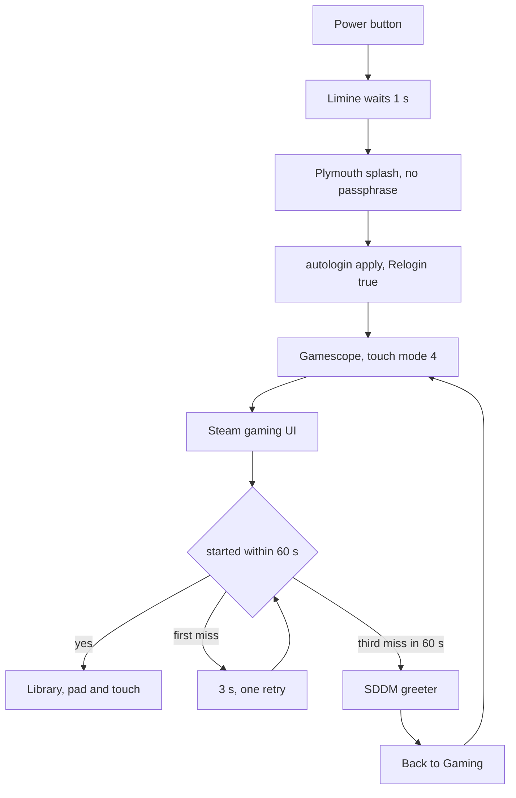

# 09 · Keyboard-free boot

Status: draft for dev-lead review, revision 1, 16 November 2026. Device: ROG Ally RC71L. Owner: dev-ux. Depends on [01](01-controller-button-map.md) (chords, hold versus tap), [02](02-mode-switch-and-dock.md) (autologin, lock, crash-loop), [03](03-first-boot-and-install.md) (wizard, encryption off), [07](07-on-screen-keyboard.md) (one keyboard per context), [08](08-mode-round-trip.md) (relogin). Lock, greeter and disk-unlock **UI** stay with AUTH. This spec states what those surfaces have to do so a person can power on and play with no keyboard.

Research: [research/touch-first-boot.md](research/touch-first-boot.md), 16 Nov 2026. That note lands via [PR #45](https://github.com/DanielJBurbridge/omarchy/pull/45) (`cursor/touch-first-boot-research-50cc`). It is not on this branch. Citations below are to that file. **Unverified** there means the note found no primary source, or the Ally has not been tried. This spec does not add distro facts of its own.

The order of work is the note's §10, best first. §11 is the RC71L package and file setup that goes with it.

## 0. Decisions

| # | Decision | Source |
|---|---|---|
| D1 | The daily path is autologin into the gamescope session that already ships. Touch is passthrough (`--default-touch-mode 4`). Steam's UI, Steam's Internet page and Steam's keyboard are the keyboardless path. | Research §10.1, §2. Spec 02 D1 |
| D2 | Wi-Fi stays NetworkManager with `wpa_supplicant`. Join in Steam → Settings → Internet when that page saves a connection. Otherwise join in `omarchy.network` with wvkbd. Do not switch the backend to iwd. | Research §5, §10.2 |
| D3 | The greeter must be able to finish a login by touch: Backspace, Shift, symbols and a submit control. Qt Virtual Keyboard in the existing SDDM theme. A separate **Back to Gaming** control returns to the gaming session and does not open the desktop. | Research §10.3, §7. Spec 02 AC 59 |
| D4 | The autologin file keeps `User=` set to the installer-created user, written once. `apply` may rewrite `Relogin`. It must not drop that user and it must not guess one. | Research §11. Spec 02 §7.1 |
| D5 | Desktop OSK is wvkbd, summoned by Command Centre long. Steam+X is not a desktop trigger. | Research §8, §10.6. Spec 07 D2 |
| D6 | Gaming OSK is Steam's. Command Centre long emits Guide+West, because Command Centre cannot be held. `steam://open/keyboard` is handled only while Steam is running. | Spec 01 §4, §7. Research §8 |
| D7 | A polkit or sudo dialog on the desktop embeds the keyboard or leaves a gap the dialog does not cover. A modal that sits on top of the keyboard is a failed prompt. Gaming does not show these prompts. Turning `desktop-lock` off still needs an interactive password. | Research §7. Spec 02 §7.4 |
| D8 | Before K07, the lock does not appear unless a physical keyboard is attached (spec 02 D11). After K07 the keypad is drawn inside the lock, the way the iPad lock screen and Plasma's lock keyboard are. hyprlock is not that keypad. | Research §4, §9, §10.5 |
| D9 | Handheld encryption stays off (spec 03 D9). Stock Omarchy encrypts by default. An opt-in disk stops at the Plymouth passphrase until a USB or 2.4 GHz keyboard. TPM2 auto-unlock and unl0kr are not chosen here. | `manual/02-getting-started.md`. Research §7, §10 |
| D10 | No system action is hold-only. Command Centre long and Armoury long are firmware events. Userspace does not time a hold of either button. | Spec 01 §4, D5 |
| D11 | A TTY still asks for a password. The recovery path is SSH, if sshd was already enabled, or a USB keyboard. There is no touch getty. | ALPHA.md. Spec 02 §7.1 |
| D12 | Do not use greetd, tuigreet, regreet, maliit, impala, iwgtk, HHD, makima, or stock steamos-manager for this goal. | Research §10.8 |

## 1. What the tree does today

Read on `feat/ally-parity-integration-20261111`. "Target" is this spec. The alpha is the gaming session, autologin and the desktop power button ([ALPHA.md](ALPHA.md)).

| Piece | Today | Target |
|---|---|---|
| Bootloader | Limine, `default/limine/limine.conf`: `timeout: 1`, `quiet: yes`, `default_entry: 2`. This x86 path is Limine. CachyOS Handheld's systemd-boot menu is that distro's installer, not this one (research [distros.md](research/distros.md)). | No keypress. The 1 s timeout elapses and the default entry boots. |
| Plymouth | `etc/plymouth/plymouthd.conf` sets `Theme=omarchy`. `default/plymouth/omarchy.script` draws passphrase bullets when Plymouth asks for a password. The script has no touch keys. | No passphrase on the handheld default. Bullets only after an encryption opt-in (D9). |
| Disk encryption | `manual/02-getting-started.md`: a normal install defaults to full encryption, and a Bluetooth keyboard cannot type the passphrase (wired or 2.4 GHz). Spec 03 D9 turns that off for the handheld variant. The ISO that asks the question is not in this repo. | Handheld default is encryption off, with the spec 03 warning on the opt-in row. |
| Autologin unit | `omarchy-handheld-autologin.service` is `Before=sddm.service`, `ExecStart=/usr/bin/omarchy-handheld-autologin apply`. `install/hardware/handheld-autologin.sh` enables it on an Ally and runs apply. The first apply, before `omarchy-gaming-session` is installed, deletes the drop-in. | Same unit. The drop-in keeps the user (D4). |
| Drop-in | `bin/omarchy-handheld-autologin` writes `/etc/sddm.conf.d/zz-omarchy-handheld.conf` with `Session=omarchy-handheld.desktop` and `Relogin=true` or `false`. There is no `User=` line. `Relogin=false` when `/run/omarchy/handheld-autologin/stop` exists. | Research §11 block: `User=<installer-created user>`, the same session, `Relogin=true` until the stop file. |
| Session | `default/gaming/wayland-sessions/omarchy-handheld.desktop` runs `omarchy-handheld-autologin`. With no stop file that execs `omarchy-session-start relogin`. `gaming_entry_selection` prints `gaming` for a relogin, unless `next` is `desktop` (spec 08). | Undocked cold boot lands in gaming. The greeter stays down. |
| Gamescope | `bin/omarchy-session-start` runs `gamescope --backend drm -e --xwayland-count 2 --default-touch-mode 4`. Research §2: mode 4 is passthrough, so touch belongs to the client. Steam is that client. | Keep mode 4. |
| Steam | `bin/omarchy-gaming-steam` runs `steam -steamos3 -steampal -steamdeck -gamepadui`. The ready FIFO reads `started` when that process holds the X socket, default 60 s (`OMARCHY_GAMING_READY_TIMEOUT`). One retry, 3 s later. Steam's own update or sign-in UI after `started` has no further deadline (`docs/rog-ally-gaming-session.md`). | Already-signed-in library, navigable by touch and the pad, with no password. |
| Crash loop | Three starts that never read `started`, with timestamps kept for 60 s, write `stop` and restart SDDM onto the greeter. A reboot empties `/run`, and the next boot writes `Relogin=true` again. | Greeter can submit, and Back to Gaming clears the stop without the desktop password (D3). The reboot path stays. |
| Greeter | `default/sddm/omarchy/Main.qml` inserts `q`–`p`, `a`–`l`, `z`–`m` and `0`–`9`. Return on a physical keyboard calls `sddm.login`. The grid has no Shift, Backspace, symbol or submit. The session index prefers a name containing `uwsm`. `etc/sddm.conf.d/10-wayland.conf` has no `InputMethod=` and no `GreeterEnvironment`. | Research §10.3 and §11. Qt Virtual Keyboard, or the same `sddm.login` call from a submit control that can backspace and shift. |
| Lock | `omarchy-system-lock` and `omarchy-system-sleep-lock` call `gaming_lock_decision` in `default/gaming/session.sh`. Before K07, no physical keyboard and effective lock `on` returns to gaming (`desktop()` returns 10; the power button's sleep-lock exits 1 and **cancels suspend**, ALPHA.md). `default-off` or `explicit-off` skips the lock and the power button still suspends. The Ally N-KEY device `0b05:1abe` is not a physical keyboard (`default/gaming/keyboard.sh`). The surface is `shell/plugins/lock/LockView.qml` (password field, fingerprint hint). It is not hyprlock. Research §4: hyprlock 0.9.7 has no PIN pad. | No lock screen without a usable keyboard (D8). Spec 02 D11's broker, which would suspend from gaming after ending the desktop, is not in this tree. |
| Desktop OSK | `Super + Ctrl + Y` runs `omarchy-toggle-desktop-keyboard` when `wvkbd-mobintl` is present and `omarchy-hw-rog-ally` succeeds (`default/hypr/bindings/utilities.lua`). That bind needs a keyboard. Command Centre long is the controller route in spec 01 and spec 07, and the `osk` profile is not in this tree (ALPHA.md). | CC long toggles wvkbd. Steam+X does not. |
| Polkit | `shell/plugins/polkit/PolkitAgent.qml` is a password layer with exclusive keyboard focus. It does not summon wvkbd. The base package list does not name another agent (research §7). | The dialog embeds the keyboard or leaves room for it (D7). |
| Wi-Fi | NetworkManager is the network service. `install/hardware/network.sh` disables `iwd.service`. There is no `wifi.backend=iwd` in this tree (research §5). `config/omarchy/shell.json` includes `omarchy.network`. `shell/plugins/panels/network/Panel.qml` has a passphrase field. Spec 04's Wi-Fi row is a radio toggle and is not built. | Steam's Internet page in gaming. The shell panel plus wvkbd on the desktop. |
| First boot | `omarchy-provision-owner` on tty1 runs the gum form (`install/provisioning/setup-form.sh`). Buffyboard is not installed. | Spec 03. Out of the alpha (L39). |
| TTY | `manual/45-troubleshooting.md` documents `Ctrl + Alt + F2`. That chord needs a keyboard. ALPHA.md: this tree has no TTY switch from the greeter, and sshd ships disabled. | D11. |

## 2. Boot flow

Happy path, handheld default, encryption off, gaming package installed, Steam already signed in, no stop file, undocked, no USB keyboard.

| Stage | Clock | What the person sees | Acceptance |
|---|---|---|---|
| Firmware | Unverified. No Ally firmware prompt is recorded in `docs/handheld/research/`. | A normal press continues. | AC 1. The menu that needs Volume Down + Power is the USB install menu (spec 03), not this boot. |
| Limine | `timeout: 1`, `quiet: yes`, `default_entry: 2` | The default entry. With no key the menu does not stay up. | AC 1 |
| Plymouth | No splash timeout in `plymouthd.conf`. It stays until the display manager. | Splash. Passphrase bullets only when the disk is encrypted. | AC 1, AC 3 |
| SDDM | The apply unit is ordered `Before=sddm.service`. | No greeter. | AC 1 |
| Gamescope / Steam | 60 s to `started`, then one retry after 3 s. | Steam's gaming UI. After `started`, an update or a sign-in screen is Steam's, and it has to be usable with the pad and Steam's keyboard. | AC 1, AC 5 |
| Library | No wall-clock in this tree past `started`. Measure on the Ally (OQ-8). | The library, or Steam's sign-in if the account is signed out. | AC 1 |

### 2.1 Encryption

`manual/02-getting-started.md` says the installation defaults to full encryption, and that a Bluetooth keyboard cannot enter the passphrase. The Plymouth theme only paints bullets. Research §10 does not rank a TPM2 unlock or an initramfs keyboard. Research §7 records `bazzite-touch-unlock` as a third-party unl0kr layer, and spec 03 already keeps unl0kr off the disk unlock.

The keyboard-free boot is the handheld default: encryption off (spec 03 D9). Choosing encryption on the install screen has to say that every later boot needs a USB or 2.4 GHz keyboard, before the user commits. TPM2 auto-unlock (`systemd-cryptenroll`) against a Plymouth touch pad stays spec 03 OQ-1. This spec does not pick it.

### 2.2 Crash loop, by distro

From research §7. Omarchy's row is this tree. The others are that note's sources. Where the note found no counter, this table says so.

| System | After gamescope or Steam dies |
|---|---|
| Bazzite | `Relogin=true` returns to the gamescope session. No counted "give up and show the greeter" path was found. |
| CachyOS Handheld | `Relogin=true` on first boot. `oneshot` boots Gamescope on a fresh boot. No crash counter in `steamos-session-select`. |
| ChimeraOS | Repeated init failure drops to the Gnome desktop. |
| Omarchy | One retry, then the desktop through `desktop()`. Three starts in 60 s that never read `started` write the stop file, set `Relogin=false`, and show the greeter. A reboot clears `/run` and the next boot writes `Relogin=true`. |

The greeter is the recovery screen. On this branch it cannot submit by touch. SSH works only when sshd was already enabled. Back to Gaming (D3) is the touch way off that screen. A reboot is the way that already works, once the machine actually power-cycles (OQ-7).

## 3. Text-input traps

| Where | What asks | Handling | Today |
|---|---|---|---|
| Limine, 1 s | A key opens the menu | Do nothing. The default entry boots | Yes |
| Plymouth passphrase | LUKS password, only if encryption is on | Handheld default skips it. Opt-in: USB or 2.4 GHz keyboard (D9). Touch does not submit | Bullets only. No touch entry |
| SDDM happy path | Nothing | Autologin (D1, D4) | Yes, once apply has run with the gaming package installed and the stop file is absent |
| Steam sign-in | Steam account | QR with the phone app, or Steam's keyboard (spec 03 W8). QR types nothing | Steam's UI. Not re-tested in this spec |
| Steam Wi-Fi | Passphrase | Steam → Settings → Internet, then the network, then Connect. Steam's keyboard. The walkthrough is third-party, not a Valve manual (research §5). Whether the page writes a NetworkManager connection with no steamos-manager and with `wpa_supplicant` is spec 03 OQ-10, still unverified | Unverified. Do not ship steamos-manager |
| Desktop Wi-Fi | Passphrase in `omarchy.network` | Open the panel, CC long for wvkbd, type, connect. If the bar widget is missing, a menu row summons `omarchy.network` (research §11). `nm-connection-editor` is the fallback window, and it needs the same keyboard. `nmtui` needs keys. impala and iwgtk need iwd, which this tree disables (research §5, D12) | Panel and passphrase field exist. Auto-show does not. The 12 Nov handover's missing waybar module is a different bar |
| sudo | Password | Not raised in gaming (D7). On the desktop, CC long, then type, unless the prompt is the polkit agent below | `/etc/sudoers.d/omarchy-handheld-autologin` is NOPASSWD for `fail`, `reset` and `apply` only |
| Polkit | Password | Desktop agent embeds wvkbd or leaves a gap (D7). Gaming uses `allow_active` for the active local session only where the action is safe (suspend, brightness, Wi-Fi radio). `desktop-lock off` stays an interactive password. A prompt that would appear inside gamescope fails closed with a line that it needs Desktop Mode | Shell agent does not summon a keyboard. The suspend broker's polkit action is spec 02 and is not in this tree |
| Lock | Password | None when no physical keyboard is attached, before K07 (D8). After K07, a keypad inside the lock: digits when the secret is a PIN, a full keypad when it is not (research §9) | Decision function ships. No keypad. wvkbd must not unlock (spec 07 K-R2) |
| Crash-loop greeter | Password, and a session | OSK that can submit, and Back to Gaming (D3). Reboot clears the stop file | Grid cannot submit. No session picker. Reboot returns to gaming |
| First boot | Username, password, Wi-Fi | Spec 03: buffyboard and the `tty` profile. Not this alpha | Gum form. A keyboard is required today |
| In-game text | The game's field | Steam's keyboard, from the field or from CC long | Documented. Guide+West versus the Steam menu is still spec 01 OQ-1 |
| TTY / emergency shell | Login password | SSH or a USB keyboard (D11). `Ctrl + Alt + F2` is the manual's chord and it needs a keyboard | No touch path |

## 4. OSK triggers

One keyboard on screen (spec 07 D1). Research §8 is the Steam half. Research §9 is the iPad half: the focused field chooses the keyboard, and a secure field keeps a keypad of its own. Hyprland cannot do the automatic half for other apps while Fcitx5 holds the only input-method slot (research §1, §3). Spec 07 already leaves `--auto` off for that reason.

| Context | Keyboard | What shows it | What does not |
|---|---|---|---|
| Gaming, gamescope | Steam's keyboard | A Steam text field. CC long, which emits Guide+West as one event (spec 01). `steam://open/keyboard` while Steam is running. Touch reaches Steam because mode 4 is passthrough | wvkbd. The helper refuses Gamescope. A held Steam+X: Command Centre has no press to hold (spec 01 §4) |
| Hyprland desktop | wvkbd | CC long. The bar button, the Apps entry and the menu row do the same. `Super + Ctrl + Y` is the keyboard bind and is not the no-keyboard route | Steam+X. Research §8: the Oct 2026 client logs `Guide button skipped due to chording` and Steam+X does nothing in Desktop Mode ([steam-for-linux #13794](https://github.com/ValveSoftware/steam-for-linux/issues/13794)). Spec 07: Steam's desktop layout stays off while the `desktop` profile is active |
| X alone | Steam's keyboard, only when Steam is running and the stock desktop config is loaded | Research §8. That config binds `button_x` to `SHOW_KEYBOARD` | The Omarchy desktop route. On the desktop profile, X is middle click, and Space while wvkbd is up (spec 01 Δ6). Do not bind the Ally's X to `SHOW_KEYBOARD` |
| `steam://open/keyboard` | Steam's keyboard | Steam handles the URL. Close is `steam://close/keyboard` | A Hyprland call is research §12 item 3, unverified. SDL can skip the OSK when it thinks a hardware keyboard is present (research §8, SDL #12595). The Ally N-KEY, InputPlumber's virtual keyboard and the bridge uinput keyboard must not count as that keyboard (spec 02's physical-keyboard rule) |
| Omarchy fields: polkit, shell search, network passphrase | wvkbd | The field's own show, because the shell owns the surface and does not need the input-method slot. Polkit embeds it or leaves a gap (D7). Shell search is spec 07 Δ-K2, and only when no physical keyboard is attached | `--auto` |
| Other desktop apps | wvkbd | CC long, after the field is focused | Auto-show. Research §9: that half waits on the input-method slot |
| Lock | Keypad inside the lock (K07) | The lock draws it. Digits for a PIN, full keypad for a passphrase (research §9) | wvkbd over the lock. hyprlock, which has no PIN widget (research §4) |
| Greeter | Qt Virtual Keyboard | The greeter shows it. A stick-to-mouse profile is what lets the pad press a key, once InputPlumber is up before SDDM (research §6, §10.4). Whether the pointer moves in this greeter is unverified | The letter grid. greetd |
| First boot, tty1 | buffyboard | Spec 03, for a text field, stopped before SDDM | The installed desktop, the lock, the disk unlock |
| Disk unlock | None on this path | A USB or 2.4 GHz keyboard after an encryption opt-in | unl0kr |

iPad pattern to copy, and only the behaviour (research §9): the keyboard follows the focused field, and the lock screen's keypad is part of the lock. Apple's software is not reusable. Plasma's `VirtualKeyboardLoader` is the same idea inside the lock, and a KDE bug records Steam's keyboard sitting under that lock, invisible (research §7). That is why D8 keeps the keypad inside the lock surface.

## 5. Chords

Hold versus tap is spec 01 §4. Command Centre (left) and Armoury (right) have no userspace hold timer. Armoury long is `KEY_F17`. Command Centre long is Ctrl+Alt+Delete, or `KEY_F20` when `hid-asus-ally` is present. Design for both. A tap fires on release.

| Action | Gaming | Desktop | Greeter / lock | Gesture |
|---|---|---|---|---|
| OSK | CC long → Guide+West, one event. Steam text field. `steam://open/keyboard` while Steam is up | CC long toggles wvkbd. Menu row does the same | Greeter: the Qt keyboard's own keys. Lock: the keypad inside the lock | Firmware event for CC long. Not a timed hold. Steam+X is not the desktop trigger (D5) |
| X | Passed through to the game (spec 01 P4) | Middle click. Space while wvkbd is visible | — | Tap. X alone opens Steam's keyboard only under the stock Steam desktop config (research §8), which this desktop profile does not use |
| Steam menu | CC tap | — | — | Tap on release |
| QAM | AC tap | — | — | Tap |
| Omarchy menu | — | AC tap | — | Tap |
| Quick-access overlay | AC long, or QAM until spec 04 | CC tap, once spec 04 lands. Power panel until then | — | AC long is `KEY_F17`. Not the OSK |
| Submit | Steam keyboard's Enter, or Y where Steam uses it | Y is Enter. A presses the key under the pointer while wvkbd is up | Greeter submit calls `sddm.login`. Lock keypad submits | Tap |
| Backspace | Steam keyboard | B, while wvkbd is up (spec 01 Δ6) | The greeter keyboard's own Backspace | Tap |
| Back to Gaming | — | — | A touch row and A on the pad. No password. Does not start the desktop session | Tap. Input ignored for 500 ms, same as spec 02's prompts |
| Profile toggle | — | AC long, and a menu row | — | Firmware key. Not a session switch (spec 02 D9) |

`Super + Ctrl + Y` stays the keyboard shortcut for a docked keyboard. It is not a controller chord.

## 6. Flows

| # | Flow | Steps |
|---|---|---|
| F1 | Power on and play | Power → Limine's 1 s → Plymouth with no passphrase → autologin → Gamescope → Steam library. No greeter, no lock, no text field. |
| F2 | Join Wi-Fi in gaming | CC tap → Settings → Internet → the network → Connect → Steam's keyboard → join. If the connection is not in NetworkManager, F3. |
| F3 | Join Wi-Fi on the desktop | Steam → Switch to Desktop → `omarchy.network` (bar, or the menu row if the bar widget is missing) → CC long → wvkbd → passphrase → connect → Switch to Gaming. |
| F4 | Three failed starts | The greeter is up. Back to Gaming, by touch or A, clears the stop and returns to Steam. The desktop session still asks for the password on the Qt keyboard. A reboot, if the machine power-cycles, also returns to gaming because `/run` is empty. |
| F5 | Desktop polkit | The dialog opens with the keyboard inside it, or with wvkbd in a gap the dialog does not cover. A finger submits. B backspaces while wvkbd is up. |
| F6 | Encryption opt-in | Install screen warns, user confirms, later boots stop on the Plymouth bullets until a USB or 2.4 GHz keyboard. Touch and the pad leave the prompt up. |
| F7 | Stuck, no SSH | USB keyboard, Enter on the greeter. With SSH already enabled from another machine: `ssh` in, remove the stop file, apply, restart SDDM (ALPHA.md). That restart ends the graphical session. |

## 7. Acceptance criteria

Each one is checked on an RC71L with no keyboard attached. The Ally N-KEY device does not count as one. A second machine may SSH in to read logs, and only if sshd was enabled first (ALPHA.md). An AC that names a control the tree does not have yet fails until that control exists. The trap table is the list of what fails today.

1. Undocked cold boot, encryption off, gaming package installed, apply already run, Steam signed in, no stop file: from the power button to a library the pad and a finger can move through. The Limine menu does not stay up. Plymouth shows no passphrase. The greeter does not appear. 5/5. `started` is in the session log within 60 s of the session start, or after the one 3 s retry.
2. Gamescope is launched with `--default-touch-mode 4`. A finger activates a Steam control.
3. With encryption on, touch and the pad leave the Plymouth passphrase up. A USB or 2.4 GHz keyboard is what continues. The handheld default install does not take this path.
4. From Steam → Settings → Internet, a finger joins a passphrase network using Steam's keyboard. If that page does not save a NetworkManager connection, F3 does, and Switch to Gaming returns to the library. impala is not used. `iwd.service` stays disabled.
5. In a Steam search field, CC long opens Steam's keyboard and a character appears. The tester does not hold Steam+X.
6. On the desktop, CC long shows wvkbd and a character reaches the focused field. Steam+X does not open a keyboard. X alone does not open one while the desktop profile is active.
7. A desktop polkit prompt, and a graphical password prompt the shell owns, can be completed by touch. The keyboard is inside the dialog or in a gap the dialog does not cover. A dialog that covers the keyboard fails this AC.
8. A cold boot that reaches the library shows no sudo prompt and no polkit prompt.
9. Before K07, with no physical keyboard, the power button does not leave a lock screen. This holds for `default-off`, `explicit-off` and `on`. The N-KEY device does not count. Today, `on` cancels the suspend (ALPHA.md). Spec 02 D11's "end the desktop, then suspend from gaming" is that spec's broker, and it is not required for this AC to pass.
10. Three gaming starts in 60 s that never read `started` show the greeter. Back to Gaming, by touch or A, reaches Steam and does not ask for the desktop password. Choosing the desktop session still requires that password, submitted from the greeter keyboard.
11. On the greeter, touch can enter a password that contains a capital and a symbol, backspace, and submit. The session that starts is the one submitted. The letter grid alone fails this AC.
12. From the gaming UI, with no keyboard, no getty appears. SSH from the other machine works only when sshd was enabled before the test.
13. After `omarchy-handheld-autologin apply`, the drop-in still names the installer-created user, `Session=omarchy-handheld.desktop`, and `Relogin=true` when the stop file is absent. The command has not invented a user.
14. The boot path does not enable greetd, impala, iwgtk, HHD, makima, or steamos-manager.

## 8. Out of the alpha

The alpha does not include these. They are filed in [alpha-followups.md](alpha-followups.md) as L35–L41.

| Follow-up | What waits |
|---|---|
| L35 | Greeter keyboard that can submit, and Back to Gaming (D3). Same hole as L25, plus the return control. |
| L36 | K07 keypad inside the lock (D8). |
| L37 | Polkit and sudo dialogs that embed the OSK or leave a gap (D7). |
| L38 | InputPlumber as a system service, with an Omarchy-written stick-to-mouse map, before SDDM (research §10.4, §11). |
| L39 | First-boot wizard and buffyboard (spec 03). |
| L40 | Plymouth stays a physical keyboard when encryption is on. Handheld default stays off (D9). |
| L41 | `apply` must keep `User=` (D4). Today's rewrite omits it. |

## 9. Open questions

For dev-lead. Several are research §12, repeated here so this spec has one list.

| # | Question | Owner |
|---|---|---|
| OQ-1 | Does spec 03 D9 stand: handheld encryption off, rather than TPM2 auto-unlock or a Plymouth touch pad? Research §10 ranks neither. | Daniel / AUTH |
| OQ-2 | Steam → Settings → Internet on this Ally: does it list SSIDs and save a NetworkManager connection with `wpa_supplicant` and no steamos-manager? Spec 03 OQ-10. Research §12.1. | Hardware test |
| OQ-3 | `xdg-open steam://open/keyboard` from Hyprland, Steam running, no physical keyboard: does a window appear, and can a finger type into a GTK passphrase? Research §12.3. | Hardware test |
| OQ-4 | Steam+X and X alone, in gamescope and in Hyprland, on the installed client. Research §12.4 says the chord is broken in Plasma Desktop Mode as of the Oct 2026 client. This spec already refuses Steam+X as the desktop trigger (D5). | Hardware test |
| OQ-5 | With `inputplumber.service` active before SDDM, does the stick move the greeter pointer, and can A press a key? Research §12.5. | Hardware test |
| OQ-6 | Which polkit agent is installed on the Ally, and does its dialog cover wvkbd? Research §12.6. The base package list does not name one. | Hardware test |
| OQ-7 | At the greeter, what does a short press of the Ally power button do? The keyboard-free escape that already exists is a reboot that clears `/run`, and only if the machine power-cycles. | Hardware test |
| OQ-8 | Wall-clock from the power button to a signed-in library, on a warm Ally, once `started` is not the whole story because Steam may still be updating. | Hardware test |
| OQ-9 | Does a normal power-on stop in Ally firmware for a key? Nothing in `docs/handheld/research/` records one. | Hardware test |
| OQ-10 | Auto-show for apps that are not Omarchy's stays blocked while Fcitx5 holds the input-method slot (research §9). Confirm manual summon remains the rule for those apps. | dev-lead |

## Sources

- This branch: `default/limine/limine.conf`, `etc/plymouth/plymouthd.conf`, `default/plymouth/omarchy.script`, `bin/omarchy-handheld-autologin`, `default/systemd/system/omarchy-handheld-autologin.service`, `install/hardware/handheld-autologin.sh`, `bin/omarchy-session-start`, `bin/omarchy-gaming-steam`, `default/gaming/session.sh`, `default/gaming/keyboard.sh`, `default/gaming/wayland-sessions/omarchy-handheld.desktop`, `default/sddm/omarchy/Main.qml`, `etc/sddm.conf.d/10-wayland.conf`, `bin/omarchy-system-lock`, `bin/omarchy-system-sleep-lock`, `bin/omarchy-system-power-button`, `shell/plugins/lock/LockView.qml`, `shell/plugins/polkit/PolkitAgent.qml`, `shell/plugins/panels/network/Panel.qml`, `config/omarchy/shell.json`, `install/hardware/network.sh`, `default/hypr/bindings/utilities.lua`, `etc/sudoers.d/omarchy-handheld-autologin`, `manual/02-getting-started.md`, `manual/35-networking.md`, `manual/45-troubleshooting.md`, [ALPHA.md](ALPHA.md).
- Specs: [01](01-controller-button-map.md), [02](02-mode-switch-and-dock.md), [03](03-first-boot-and-install.md), [07](07-on-screen-keyboard.md), [08](08-mode-round-trip.md).
- Research, via [PR #45](https://github.com/DanielJBurbridge/omarchy/pull/45), not merged here: [research/touch-first-boot.md](research/touch-first-boot.md). Distro boot rows in §2.2 are that note's §7. Steam+X in Desktop Mode is that note's §8 and [steam-for-linux #13794](https://github.com/ValveSoftware/steam-for-linux/issues/13794).
