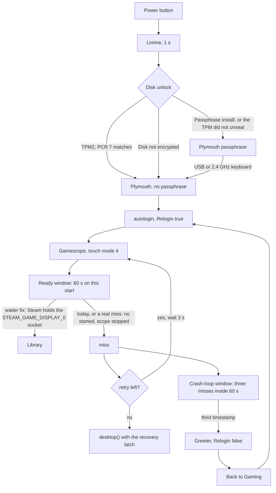

# 09 · Keyboard-free boot

Status: draft for dev-lead review, revision 2, 16 November 2026. Device: ROG Ally RC71L. Owner: dev-ux. Depends on [01](01-controller-button-map.md) (chords, hold versus tap), [02](02-mode-switch-and-dock.md) (autologin, lock, crash-loop), [03](03-first-boot-and-install.md) (wizard, disk unlock), [07](07-on-screen-keyboard.md) (one keyboard per context), [08](08-mode-round-trip.md) (relogin). Lock and greeter **UI** stay with AUTH. Disk unlock is [tpm-unlock-installer-spec.md](tpm-unlock-installer-spec.md). This spec states what those surfaces have to do so a person can power on and play with no keyboard.

Research: [research/touch-first-boot.md](research/touch-first-boot.md), 16 Nov 2026, merged from [PR #45](https://github.com/DanielJBurbridge/omarchy/pull/45). The polkit and greeter corrections land via [PR #47](https://github.com/DanielJBurbridge/omarchy/pull/47), which is not on this branch. **Unverified** means the note found no primary source, or the Ally has not been tried. This spec does not add distro facts of its own.

The order of work is the note's §10, best first. §11 is the RC71L package and file setup that goes with it.

## 0. Decisions

| # | Decision | Source |
|---|---|---|
| D1 | The daily path is autologin into the gamescope session that already ships. Touch is passthrough (`--default-touch-mode 4`). Steam's UI, Steam's Internet page and Steam's keyboard are the keyboardless path. | Research §10.1, §2. Spec 02 D1 |
| D2 | Wi-Fi stays NetworkManager with `wpa_supplicant`. Join in Steam → Settings → Internet when that page saves a connection. Otherwise join in `omarchy.network` with wvkbd. Do not switch the backend to iwd. | Research §5, §10.2 |
| D3 | On the original Ally’s built-in panel, the greeter offers **Keyboard** and **Sign in**. On a dock display a short primary click focuses the password field and holding the primary button opens the keyboard. SDDM sets `QT_IM_MODULE=qtvirtualkeyboard` and `QT_VIRTUALKEYBOARD_DESKTOP_DISABLE=1` in its greeter environment. An administrator’s `[General] InputMethod` takes precedence. **Back to Gaming** remains a separate proposed action. | [Greeter configuration](../../etc/sddm.conf.d/10-wayland.conf) · [Greeter actions](../../default/sddm/omarchy/Main.qml) · Spec 02 AC 59 |
| D4 | The autologin file keeps `User=` set to the installer-created user, written once. `apply` may rewrite `Relogin`. It must not drop that user and it must not guess one. | Research §11. Spec 02 §7.1 |
| D5 | Desktop OSK is wvkbd, summoned by Command Centre long. Steam+X is not a desktop trigger. | Research §8, §10.6. Spec 07 D2 |
| D6 | Gaming OSK is Steam's. Command Centre long emits Guide+West, because Command Centre cannot be held. `steam://open/keyboard` is handled only while Steam is running. | Spec 01 §4, §7. Research §8 |
| D7 | The password prompt is the shell service `omarchy.polkit`. `PolkitAgent.qml` takes exclusive keyboard focus and has no keyboard of its own, so wvkbd cannot type into it. The handheld path puts a keypad inside that dialog, or it keeps the prompt off the path with an `allow_active` rule for the active local session where that is safe. Turning `desktop-lock` off still needs an interactive password. | [PR #47](https://github.com/DanielJBurbridge/omarchy/pull/47). Spec 02 §7.4 |
| D8 | Before K07, the lock does not appear unless a physical keyboard is attached (spec 02 D11). After K07 the keypad is drawn inside the lock, the way the iPad lock screen and Plasma's lock keyboard are. hyprlock is not that keypad. | Research §4, §9, §10.5 |
| D9 | A handheld install encrypts the disk and unlocks it with TPM2 bound to PCR 7, no PIN. The recovery passphrase is mandatory and stays in a passphrase slot. "Passphrase every boot" stops at the Plymouth passphrase until a USB or 2.4 GHz keyboard. "Security chip + PIN" is L68, not this boot. The earlier decision said handheld encryption stays off. That premise was wrong: the checked RC71L was already LUKS2. With Secure Boot off, auto-unlock protects a drive removed from the handheld, not the handheld at rest. | [tpm-unlock-installer-spec.md](tpm-unlock-installer-spec.md), [tpm-unlock.md](tpm-unlock.md). Daniel's choice, as reported by dev-lead, 16 Nov 2026 (question card); Daniel also asked for both auto-unlock and TPM2+PIN to be offered |
| D10 | No system action is hold-only. Command Centre long and Armoury long are firmware events. Userspace does not time a hold of either button. | Spec 01 §4, D5 |
| D11 | A TTY still asks for a password. The recovery path is SSH, if sshd was already enabled, or a USB keyboard. There is no touch getty. | ALPHA.md. Spec 02 §7.1 |
| D12 | Do not use greetd, tuigreet, regreet, maliit, impala, iwgtk, HHD, makima, or stock steamos-manager for this goal. | Research §10.8 |

## 1. What the tree does today

Read on `feat/ally-parity-integration-20261111`. "Target" is this spec. The alpha is the gaming session, autologin and the desktop power button ([ALPHA.md](ALPHA.md)).

| Piece | Today | Target |
|---|---|---|
| Bootloader | Limine, `default/limine/limine.conf`: `timeout: 1`, `quiet: yes`, `default_entry: 2`. This x86 path is Limine. CachyOS Handheld's systemd-boot menu is that distro's installer, not this one (research [distros.md](research/distros.md)). | No keypress. The 1 s timeout elapses and the default entry boots. |
| Plymouth | `etc/plymouth/plymouthd.conf` sets `Theme=omarchy`. `default/plymouth/omarchy.script` draws passphrase bullets when Plymouth asks for a password. The script has no touch keys. | No passphrase on the TPM default (D9). Bullets when the person chose passphrase every boot, or when PCR 7 did not unseal. |
| Disk encryption | `manual/02-getting-started.md`: a normal install defaults to full encryption, and a Bluetooth keyboard cannot type the passphrase (wired or 2.4 GHz). The RC71L image is the busybox `encrypt` hook (`etc/mkinitcpio.conf.d/00-omarchy-hooks.conf`) and stops at that passphrase. The ISO that asks the question is not in this repo. | Handheld default is TPM2, PCR 7, passphrase slot kept. [tpm-unlock-installer-spec.md](tpm-unlock-installer-spec.md). |
| Autologin unit | `omarchy-handheld-autologin.service` is `Before=sddm.service`, `ExecStart=/usr/bin/omarchy-handheld-autologin apply`. `install/hardware/handheld-autologin.sh` enables it on an Ally and runs apply. The first apply, before `omarchy-gaming-session` is installed, deletes the drop-in. | Same unit. The drop-in keeps the user (D4). |
| Drop-in | `bin/omarchy-handheld-autologin` writes `/etc/sddm.conf.d/zz-omarchy-handheld.conf` with `Session=omarchy-handheld.desktop` and `Relogin=true` or `false`. There is no `User=` line. `Relogin=false` when `/run/omarchy/handheld-autologin/stop` exists. | Research §11 block: `User=<installer-created user>`, the same session, `Relogin=true` until the stop file. |
| Session | `default/gaming/wayland-sessions/omarchy-handheld.desktop` runs `omarchy-handheld-autologin`. The supervisor applies the saved or dock-aware preference on the first verified automatic login of each boot. Relogin defaults to Gaming and honours a one-use Desktop request (spec 08). | With Auto, an undocked cold boot lands in Gaming. |
| Gamescope | `bin/omarchy-session-start` runs `gamescope --backend drm -e --xwayland-count 2 --default-touch-mode 4`. Research §2: mode 4 is passthrough, so touch belongs to the client. Steam is that client. | Keep mode 4. |
| Steam | `bin/omarchy-gaming-steam` runs `steam -steamos3 -steampal -steamdeck -gamepadui` and exports `STEAM_MULTIPLE_XWAYLANDS=1`. It writes `started` only when the Steam pid or a child holds `/tmp/.X11-unix/X<n>` taken from `$DISPLAY` (the root Xwayland). It never reads `STEAM_GAME_DISPLAY_0`. With `--xwayland-count 2` and `-e`, Gamescope puts Steam on that extra display ([research/gamescope-external-overlay.md](research/gamescope-external-overlay.md)), so the socket check misses. The 60 s waiter (`OMARCHY_GAMING_READY_TIMEOUT`) logs "Gamescope did not start its Steam child within 60 seconds.", `stop_gaming` kills the scope, one retry 3 s later does the same, then the recovery latch and `desktop()`. The 12 Nov boot of this line came up on the desktop ([HANDOVER.md](HANDOVER.md)). | Hard dependency on dev-blue's waiter fix (cloud agent bc-fe6afac0). The ready signal is the Steam pid or a child holding the X socket named by `STEAM_GAME_DISPLAY_0`. After that signal, an already-signed-in library, by touch and the pad, with no password. |
| Crash loop | Three starts that never read `started`, with timestamps kept for 60 s, write `stop` and restart SDDM onto the greeter. A reboot empties `/run`, and the next boot writes `Relogin=true` again. | Greeter can submit, and Back to Gaming clears the stop without the desktop password (D3). The reboot path stays. |
| Greeter | `default/sddm/omarchy/Main.qml` inserts `q`–`p`, `a`–`l`, `z`–`m` and `0`–`9`. Return on a physical keyboard calls `sddm.login`. The grid has no Shift, Backspace, symbol or submit. The session index prefers a name containing `uwsm`. `etc/sddm.conf.d/10-wayland.conf` has no `InputMethod=` and no `GreeterEnvironment`. | `GreeterEnvironment` with `QT_IM_MODULE=qtvirtualkeyboard` so Qt Virtual Keyboard can submit by touch (PR #47). `[General] InputMethod=` stays unset. No kwin `--inputmethod` on `start-hyprland`. |
| Lock | `omarchy-system-lock` and `omarchy-system-sleep-lock` call `gaming_lock_decision` in `default/gaming/session.sh`. Before K07, no physical keyboard and effective lock `on` returns to gaming (`desktop()` returns 10; the power button's sleep-lock exits 1 and **cancels suspend**, ALPHA.md). `default-off` or `explicit-off` skips the lock and the power button still suspends. The Ally N-KEY device `0b05:1abe` is not a physical keyboard (`default/gaming/keyboard.sh`). The surface is `shell/plugins/lock/LockView.qml` (password field, fingerprint hint). It is not hyprlock. Research §4: hyprlock 0.9.7 has no PIN pad. | No lock screen without a usable keyboard (D8). Spec 02 D11's broker, which would suspend from gaming after ending the desktop, is not in this tree. |
| Desktop OSK | `Super + Ctrl + Y` runs `omarchy-toggle-desktop-keyboard` when `wvkbd-mobintl` is present and `omarchy-hw-rog-ally` succeeds (`default/hypr/bindings/utilities.lua`). That bind needs a keyboard. Command Centre long is the controller route in spec 01 and spec 07, and the `osk` profile is not in this tree (ALPHA.md). | CC long toggles wvkbd. Steam+X does not. |
| Polkit | `omarchy.polkit` is a keep-loaded shell service (`shell/plugins/polkit/manifest.json`). `PolkitAgent.qml` is a full-screen overlay, `WlrKeyboardFocus.Exclusive`, with a password field and no keyboard. wvkbd cannot type into it (PR #47). | A keypad inside that dialog, or no polkit prompt on the handheld path (D7). A gap for wvkbd is not a fix. |
| Wi-Fi | NetworkManager is the network service. `install/hardware/network.sh` disables `iwd.service`. There is no `wifi.backend=iwd` in this tree (research §5). `config/omarchy/shell.json` includes `omarchy.network`. `shell/plugins/panels/network/Panel.qml` has a passphrase field. Spec 04's Wi-Fi row is a radio toggle and is not built. | Steam's Internet page in gaming. The shell panel plus wvkbd on the desktop. |
| First boot | `omarchy-provision-owner` on tty1 runs the gum form (`install/provisioning/setup-form.sh`). Buffyboard is not installed. | Spec 03. Out of the alpha (L39). |
| TTY | `manual/45-troubleshooting.md` documents `Ctrl + Alt + F2`. That chord needs a keyboard. ALPHA.md: this tree has no TTY switch from the greeter, and sshd ships disabled. | D11. |

## 2. Boot flow

Handheld default: the disk is LUKS, unlocked by TPM2 bound to PCR 7, no PIN and no passphrase prompt. An already-unencrypted disk still has no passphrase prompt. Gaming package installed, Steam already signed in, no stop file, undocked, no USB keyboard. The library edge is the waiter fix. Today the ready window times out and one boot ends at `desktop()`, not the greeter. The ready window and the crash-loop window are different clocks. A TPM miss is a different branch: it stops on the Plymouth passphrase and does not reach autologin until that passphrase is typed.

| Stage | Clock | What the person sees | Acceptance |
|---|---|---|---|
| Firmware | Unverified. No Ally firmware prompt is recorded in `docs/handheld/research/`. | A normal press continues. | AC 1. The menu that needs Volume Down + Power is the USB install menu (spec 03), not this boot. |
| Limine | `timeout: 1`, `quiet: yes`, `default_entry: 2` | The default entry. With no key the menu does not stay up. | AC 1 |
| Plymouth | No splash timeout in `plymouthd.conf`. It stays until the display manager. | Splash. No passphrase when PCR 7 unseals. Bullets when it does not, or when the install chose a passphrase. | AC 1, AC 3 |
| SDDM | The apply unit is ordered `Before=sddm.service`. | No greeter. | AC 1 |
| Gamescope / Steam | Ready window: 60 s for `started`, one retry after 3 s. Today the waiter watches the root `$DISPLAY` socket and ignores `STEAM_GAME_DISPLAY_0`, so both attempts time out, the scope is killed, and `desktop()` runs with the recovery latch. The library path waits on bc-fe6afac0. | After the waiter fix, Steam's gaming UI. Until then, the desktop. | AC 1, AC 5 |
| Library | No wall-clock until the waiter fix. `started` from the root `$DISPLAY` socket is not the signal (OQ-8). | The library, or Steam's sign-in if the account is signed out. | AC 1 |

### 2.1 Encryption

`manual/02-getting-started.md` says the installation defaults to full encryption, and that a Bluetooth keyboard cannot enter the passphrase. The Plymouth theme only paints bullets. The RC71L image uses the busybox `encrypt` hook, so a TPM token would not be read until the hooks and the cmdline change. That change is [tpm-unlock.md](tpm-unlock.md). The install screen that offers it is [tpm-unlock-installer-spec.md](tpm-unlock-installer-spec.md).

The keyboard-free boot is the handheld default: TPM2 bound to PCR 7, no PIN, recovery passphrase kept (D9). "Passphrase every boot" has to say that every later boot needs a USB or 2.4 GHz keyboard, before the user commits. A numeric PIN on a touch keypad is L68. unl0kr stays off this boot until that item lands. Research §7 records `bazzite-touch-unlock` as a third-party unl0kr layer, and this spec still does not put that package on the disk unlock.

### 2.2 Crash loop, by distro

From research §7. Omarchy's row is this tree. The others are that note's sources. Where the note found no counter, this table says so.

| System | After gamescope or Steam dies |
|---|---|
| Bazzite | `Relogin=true` returns to the gamescope session. No counted "give up and show the greeter" path was found. |
| CachyOS Handheld | `Relogin=true` on first boot. `oneshot` boots Gamescope on a fresh boot. No crash counter in `steamos-session-select`. |
| ChimeraOS | Repeated init failure drops to the Gnome desktop. |
| Omarchy | One retry, then the desktop through `desktop()`. Three starts in 60 s that never read `started` write the stop file, set `Relogin=false`, and show the greeter. A reboot clears `/run` and the next boot writes `Relogin=true`. |

The greeter is the recovery screen. On this branch it cannot submit by touch. SSH works only when sshd was already enabled. Back to Gaming (D3) is the touch way off that screen. A reboot is the way that already works, once the machine actually power-cycles (OQ-7).

## 3. Text-input traps

| Where | What asks | Handling | Today |
|---|---|---|---|
| Limine, 1 s | A key opens the menu | Do nothing. The default entry boots | Yes |
| Plymouth passphrase | LUKS passphrase, or the TPM PIN once L68 exists | TPM default skips it when PCR 7 matches. Otherwise a USB or 2.4 GHz keyboard (D9). Touch does not submit | Bullets only. No touch entry |
| SDDM happy path | Nothing | Autologin (D1, D4) | Yes, once apply has run with the gaming package installed and the stop file is absent |
| Steam sign-in | Steam account | QR with the phone app, or Steam's keyboard (spec 03 W8). QR types nothing | Steam's UI. Not re-tested in this spec |
| Steam Wi-Fi | Passphrase | Steam → Settings → Internet, then the network, then Connect. Steam's keyboard. The walkthrough is third-party, not a Valve manual (research §5). Whether the page writes a NetworkManager connection with no steamos-manager and with `wpa_supplicant` is spec 03 OQ-10, still unverified | Unverified. Do not ship steamos-manager |
| Desktop Wi-Fi | Passphrase in `omarchy.network` | Open the panel, CC long for wvkbd, type, connect. If the bar widget is missing, a menu row summons `omarchy.network` (research §11). `nm-connection-editor` is the fallback window, and it needs the same keyboard. `nmtui` needs keys. impala and iwgtk need iwd, which this tree disables (research §5, D12) | Panel and passphrase field exist. Auto-show does not. The 12 Nov handover's missing waybar module is a different bar |
| sudo | Password | Not raised in gaming (D7). On the desktop, CC long, then type, unless the prompt is the polkit agent below | `omarchy-gaming-session` installs `/etc/sudoers.d/omarchy-handheld-autologin` at mode 0440, NOPASSWD for `fail`, `reset` and `apply` only. The base tree does not ship it |
| Polkit (`omarchy.polkit`) | Password | Hard trap. Exclusive keyboard focus and no keyboard of its own, so wvkbd cannot type into it. Either a keypad inside `PolkitAgent.qml`, or the prompt stays off the handheld path (`allow_active` for the active local session where that is safe: suspend, brightness, Wi-Fi radio). `desktop-lock off` still needs an interactive password. A prompt inside gamescope fails closed with a line that it needs Desktop Mode | Yes. PR #47 |
| Lock | Password | None when no physical keyboard is attached, before K07 (D8). After K07, a keypad inside the lock: digits when the secret is a PIN, a full keypad when it is not (research §9) | Decision function ships. No keypad. wvkbd must not unlock (spec 07 K-R2) |
| Crash-loop greeter | Password, and a session | OSK that can submit, and Back to Gaming (D3). Reboot clears the stop file | Grid cannot submit. No session picker. Reboot returns to gaming |
| First boot | Username, password, Wi-Fi | Spec 03: buffyboard and the `tty` profile. Not this alpha | Gum form. A keyboard is required today |
| In-game text | The game's field | Steam's keyboard, from the field or from CC long | Documented. Guide+West versus the Steam menu is still spec 01 OQ-1 |
| TTY / emergency shell | Login password | SSH or a USB keyboard (D11). `Ctrl + Alt + F2` is the manual's chord and it needs a keyboard | No touch path |

## 4. OSK triggers

One keyboard on screen (spec 07 D1). Research §8 is the Steam half. Research §9 is the iPad half: the focused field chooses the keyboard, and a secure field keeps a keypad of its own. Hyprland cannot do the automatic half for other apps while Fcitx5 holds the only input-method slot (research §1, §3). Spec 07 already leaves `--auto` off for that reason.

| Context | Keyboard | What shows it | What does not |
|---|---|---|---|
| Gaming, gamescope | Steam's keyboard | A Steam text field. CC long, which emits Guide+West as one event (spec 01). `steam://open/keyboard` while Steam is running. Touch reaches Steam because mode 4 is passthrough | wvkbd. The helper refuses Gamescope. A held Steam+X: Command Centre has no press to hold (spec 01 §4) |
| Hyprland desktop | wvkbd | CC long. The bar button, the Apps entry and the menu row do the same. `Super + Ctrl + Y` is the keyboard bind and is not the no-keyboard route | Steam+X. Research §8: the Oct 2026 client logs `Guide button skipped due to chording` and Steam+X does nothing in Desktop Mode ([steam-for-linux #13794](https://github.com/ValveSoftware/steam-for-linux/issues/13794)). Spec 07: Steam's desktop layout stays off while the `desktop` profile is active |
| X alone | Steam's keyboard, only when Steam is running and the stock desktop config is loaded | Research §8. That config binds `button_x` to `SHOW_KEYBOARD` | The Omarchy desktop route. On the desktop profile, X is middle click, and Space while wvkbd is up (spec 01 Δ6). Do not bind the Ally's X to `SHOW_KEYBOARD` |
| `steam://open/keyboard` | Steam's keyboard | Steam handles the URL. Close is `steam://close/keyboard` | A Hyprland call is research §12 item 3, unverified. SDL can skip the OSK when it thinks a hardware keyboard is present (research §8, SDL #12595). The Ally N-KEY, InputPlumber's virtual keyboard and the bridge uinput keyboard must not count as that keyboard (spec 02's physical-keyboard rule) |
| Omarchy fields: shell search, network passphrase | wvkbd | The field's own show, because the shell owns the surface and does not need the input-method slot. Shell search is spec 07 Δ-K2, and only when no physical keyboard is attached | `--auto` |
| `omarchy.polkit` | A keypad drawn inside the dialog | The dialog draws it. The other path is no prompt (D7) | wvkbd in a gap. Exclusive focus means those keys never arrive |
| Other desktop apps | wvkbd | CC long, after the field is focused | Auto-show. Research §9: that half waits on the input-method slot |
| Lock | Keypad inside the lock (K07) | The lock draws it. Digits for a PIN, full keypad for a passphrase (research §9) | wvkbd over the lock. hyprlock, which has no PIN widget (research §4) |
| Greeter | Qt Virtual Keyboard | `GreeterEnvironment` sets `QT_IM_MODULE=qtvirtualkeyboard` (PR #47). Touch types and submits. A stick-to-mouse profile is what lets the pad press a key, once InputPlumber is up before SDDM (research §6, §10.4). Whether the pointer moves in this greeter is unverified | The letter grid. `[General] InputMethod=`. kwin `--inputmethod` on `start-hyprland`. greetd |
| First boot, tty1 | buffyboard | Spec 03, for a text field, stopped before SDDM | The installed desktop, the lock, the disk unlock |
| Disk unlock | None on the TPM path | A USB or 2.4 GHz keyboard when PCR 7 does not unseal, or when the install chose a passphrase | unl0kr, until L68 |

iPad pattern to copy, and only the behaviour (research §9): the keyboard follows the focused field, and the lock screen's keypad is part of the lock. Apple's software is not reusable. Plasma's `VirtualKeyboardLoader` is the same idea inside the lock, and a KDE bug records Steam's keyboard sitting under that lock, invisible (research §7). That is why D8 keeps the keypad inside the lock surface.

## 5. Chords

Hold versus tap is spec 01 §4. Command Centre (left) and Armoury (right) have no userspace hold timer. Armoury long is `KEY_F17`. Command Centre long is Ctrl+Alt+Delete, or `KEY_F20` when `hid-asus-ally` is present. Design for both. A tap fires on release.

| Action | Gaming | Desktop | Greeter / lock | Gesture |
|---|---|---|---|---|
| OSK | CC long → Guide+West, one event. Steam text field. `steam://open/keyboard` while Steam is up | CC long toggles wvkbd. Menu row does the same | Greeter: the Qt keyboard's own keys. Lock: the keypad inside the lock | Firmware event for CC long. Not a timed hold. Steam+X is not the desktop trigger (D5) |
| X | Passed through to the game (spec 01 P4) | Middle click. Space while wvkbd is visible | — | Tap. X alone opens Steam's keyboard only under the stock Steam desktop config (research §8), which this desktop profile does not use |
| Steam menu | CC tap | — | — | Tap on release |
| QAM | AC tap | — | — | Tap |
| Omarchy menu | — | AC tap | — | Tap |
| Quick-access overlay | AC long, or QAM until spec 04 | CC tap, once spec 04 lands. Power panel until then | — | AC long is `KEY_F17`. Not the OSK |
| Submit | Steam keyboard's Enter, or Y where Steam uses it | Y is Enter. A presses the key under the pointer while wvkbd is up | Greeter submit calls `sddm.login`. Lock keypad submits | Tap |
| Backspace | Steam keyboard | B, while wvkbd is up (spec 01 Δ6) | The greeter keyboard's own Backspace | Tap |
| Back to Gaming | — | — | A touch row and A on the pad. No password. Does not start the desktop session | Tap. Input ignored for 500 ms, same as spec 02's prompts |
| Profile toggle | — | AC long, and a menu row | — | Firmware key. Not a session switch (spec 02 D9) |

`Super + Ctrl + Y` stays the keyboard shortcut for a docked keyboard. It is not a controller chord.

## 6. Flows

| # | Flow | Steps |
|---|---|---|
| F1 | Power on and play | Target, only after the waiter fix (bc-fe6afac0): Power → Limine's 1 s → TPM2 unseals the disk (PCR 7) → Plymouth with no passphrase → autologin → Gamescope → Steam library, once Steam holds the `STEAM_GAME_DISPLAY_0` socket. No greeter, no lock, no text field. Today the same boot times out on the root `$DISPLAY` socket, kills the scope, retries once, then `desktop()` with the recovery latch. The image on the checked Ally still stops at the Plymouth passphrase, because the hook is busybox `encrypt`. |
| F2 | Join Wi-Fi in gaming | CC tap → Settings → Internet → the network → Connect → Steam's keyboard → join. If the connection is not in NetworkManager, F3. |
| F3 | Join Wi-Fi on the desktop | Steam → Switch to Desktop → `omarchy.network` (bar, or the menu row if the bar widget is missing) → CC long → wvkbd → passphrase → connect → Switch to Gaming. |
| F4 | Three failed starts | The greeter is up. Back to Gaming, by touch or A, clears the stop and returns to Steam. The desktop session still asks for the password on the Qt keyboard. A reboot, if the machine power-cycles, also returns to gaming because `/run` is empty. |
| F5 | Desktop polkit | `omarchy.polkit` either draws a keypad the finger can use, or the prompt does not appear. wvkbd beside the dialog does not submit, because the layer takes exclusive keyboard focus. |
| F6 | Disk unlock choice | Install screen: Unlock automatically (default), Passphrase every boot (keyboard warning), Security chip + PIN (visible, not selectable). Passphrase every boot, and a TPM unlock that did not unseal, stop on the Plymouth bullets until a USB or 2.4 GHz keyboard. Touch and the pad leave the prompt up. |
| F7 | Stuck, no SSH | USB keyboard, Enter on the greeter. With SSH already enabled from another machine: `ssh` in, remove the stop file, apply, restart SDDM (ALPHA.md). That restart ends the graphical session. |

## 7. Acceptance criteria

Each one is checked on an RC71L with no keyboard attached. The Ally N-KEY device does not count as one. A second machine may SSH in to read logs, and only if sshd was enabled first (ALPHA.md). An AC that names a control the tree does not have yet fails until that control exists. The trap table is the list of what fails today. AC 1, F1, and any check that starts from the Steam library (AC 2, AC 4, AC 5, AC 8) wait on dev-blue's waiter fix, cloud agent bc-fe6afac0. Until that fix the boot ends in `desktop()`.

1. Hard dependency on dev-blue's waiter fix (cloud agent bc-fe6afac0). Until it lands, this AC cannot pass: `omarchy-gaming-steam` writes `started` only when Steam holds the root `$DISPLAY` socket, never the socket named by `STEAM_GAME_DISPLAY_0`. The 60 s waiter times out, `stop_gaming` kills the scope, the one 3 s retry does the same, and `desktop()` runs with the recovery latch. The greeter does not appear on that single boot. After the fix, the ready signal is the Steam pid or a child holding `/tmp/.X11-unix/X<n>` for the display in `STEAM_GAME_DISPLAY_0`. Then: undocked cold boot, gaming package installed, apply already run, Steam signed in, no stop file, from the power button to a library the pad and a finger can move through. The disk is the handheld default: LUKS unlocked by TPM2 bound to PCR 7, no PIN, no passphrase prompt. An already-unencrypted disk has no passphrase prompt either. The Limine menu does not stay up. Plymouth shows no passphrase. The greeter does not appear. 5/5. That `started` line is in the session log within 60 s of the session start, or after the one 3 s retry. The checked Ally's image still uses busybox `encrypt`, so this AC stays red until the TPM path in [tpm-unlock.md](tpm-unlock.md) is what boots.
2. Gamescope is launched with `--default-touch-mode 4`. A finger activates a Steam control.
3. Passphrase every boot, or a TPM unlock that did not unseal: touch and the pad leave the Plymouth passphrase up. A USB or 2.4 GHz keyboard is what continues. The recovery passphrase slot is still enrolled. The handheld default install does not take the passphrase-every-boot path.
4. From Steam → Settings → Internet, a finger joins a passphrase network using Steam's keyboard. If that page does not save a NetworkManager connection, F3 does, and Switch to Gaming returns to the library. impala is not used. `iwd.service` stays disabled.
5. In a Steam search field, CC long opens Steam's keyboard and a character appears. The tester does not hold Steam+X.
6. On the desktop, CC long shows wvkbd and a character reaches the focused field. Steam+X does not open a keyboard. X alone does not open one while the desktop profile is active.
7. Hard trap. `omarchy.polkit` either contains a keypad a finger can use to submit the password, or the handheld path does not show that prompt (`allow_active` for the active local session where that is safe). wvkbd left in a gap fails this AC: the dialog takes exclusive keyboard focus, so those keys never arrive. Turning `desktop-lock` off still needs an interactive password, and that password is typed on the keypad inside the dialog.
8. A cold boot that reaches the library shows no sudo prompt and no polkit prompt. Reaching the library is AC 1. On the desktop that today's boot opens, AC 7 is the polkit trap.
9. Before K07, with no physical keyboard, the power button does not leave a lock screen. This holds for `default-off`, `explicit-off` and `on`. The N-KEY device does not count. Today, `on` cancels the suspend (ALPHA.md). Spec 02 D11's "end the desktop, then suspend from gaming" is that spec's broker, and it is not required for this AC to pass.
10. Three gaming starts in 60 s that never read `started` show the greeter. Back to Gaming, by touch or A, reaches Steam and does not ask for the desktop password. Choosing the desktop session still requires that password, submitted from the greeter keyboard.
11. On the greeter, with `GreeterEnvironment` setting `QT_IM_MODULE=qtvirtualkeyboard`, touch can enter a password that contains a capital and a symbol, backspace, and submit. The session that starts is the one submitted. The letter grid alone fails this AC. `[General] InputMethod=` stays unset.
12. From the gaming UI, with no keyboard, no getty appears. SSH from the other machine works only when sshd was enabled before the test.
13. After `omarchy-handheld-autologin apply`, the drop-in still names the installer-created user, `Session=omarchy-handheld.desktop`, and `Relogin=true` when the stop file is absent. The command has not invented a user.
14. The boot path does not enable greetd, impala, iwgtk, HHD, makima, or steamos-manager.

## 8. Out of the alpha

The alpha does not include these. They are filed in [alpha-followups.md](alpha-followups.md) as L35–L41.

| Follow-up | What waits |
|---|---|
| L35 | Greeter `GreeterEnvironment` with `QT_IM_MODULE=qtvirtualkeyboard` so touch can submit, and Back to Gaming (D3). Same hole as L25, plus the return control. |
| L36 | K07 keypad inside the lock (D8). |
| L37 | A keypad inside `omarchy.polkit`, or polkit prompts kept off the handheld path (D7). A gap for wvkbd is not that fix. |
| L38 | InputPlumber as a system service, with an Omarchy-written stick-to-mouse map, before SDDM (research §10.4, §11). |
| L39 | First-boot wizard and buffyboard (spec 03). |
| L40 | Plymouth stays a physical keyboard when the TPM does not unseal, or when the install chose a passphrase. The handheld default is TPM2, PCR 7 (D9). The PIN keypad is L68. |
| L41 | `apply` must keep `User=` (D4). Today's rewrite omits it. |

## 9. Open questions

For dev-lead. Several are research §12, repeated here so this spec has one list.

| # | Question | Owner |
|---|---|---|
| OQ-1 | **Resolved.** Daniel's choice, as reported by dev-lead, 16 Nov 2026 (question card); Daniel also asked for both auto-unlock and TPM2+PIN to be offered. Not a quote. Handheld default is TPM2 auto-unlock, PCR 7, recovery passphrase kept. The old premise that encryption stays off was wrong: the checked RC71L was already LUKS2. A Plymouth touch pad is not this default. The PIN keypad is L68. | [tpm-unlock-installer-spec.md](tpm-unlock-installer-spec.md) |
| OQ-2 | Steam → Settings → Internet on this Ally: does it list SSIDs and save a NetworkManager connection with `wpa_supplicant` and no steamos-manager? Spec 03 OQ-10. Research §12.1. | Hardware test |
| OQ-3 | `xdg-open steam://open/keyboard` from Hyprland, Steam running, no physical keyboard: does a window appear, and can a finger type into a GTK passphrase? Research §12.3. | Hardware test |
| OQ-4 | Steam+X and X alone, in gamescope and in Hyprland, on the installed client. Research §12.4 says the chord is broken in Plasma Desktop Mode as of the Oct 2026 client. This spec already refuses Steam+X as the desktop trigger (D5). | Hardware test |
| OQ-5 | With `inputplumber.service` active before SDDM, does the stick move the greeter pointer, and can A press a key? Research §12.5. | Hardware test |
| OQ-6 | `omarchy.polkit` is the agent (PR #47). Which actions stay `allow_active` for the active local session, and which still need the keypad inside the dialog? `desktop-lock off` still needs a password. | dev-lead / AUTH |
| OQ-7 | At the greeter, what does a short press of the Ally power button do? The keyboard-free escape that already exists is a reboot that clears `/run`, and only if the machine power-cycles. | Hardware test |
| OQ-8 | After the waiter fix (bc-fe6afac0) writes `started` from the `STEAM_GAME_DISPLAY_0` socket, what is the wall-clock from the power button to a signed-in library on a warm Ally? The root `$DISPLAY` socket is not that signal. Steam may still be updating after the new signal. | Hardware test, after the waiter fix |
| OQ-9 | Does a normal power-on stop in Ally firmware for a key? Nothing in `docs/handheld/research/` records one. | Hardware test |
| OQ-10 | Auto-show for apps that are not Omarchy's stays blocked while Fcitx5 holds the input-method slot (research §9). Confirm manual summon remains the rule for those apps. | dev-lead |

## Sources

- This branch: `default/limine/limine.conf`, `etc/plymouth/plymouthd.conf`, `default/plymouth/omarchy.script`, `bin/omarchy-handheld-autologin`, `default/systemd/system/omarchy-handheld-autologin.service`, `install/hardware/handheld-autologin.sh`, `bin/omarchy-session-start`, `bin/omarchy-gaming-steam`, `default/gaming/session.sh`, `default/gaming/keyboard.sh`, `default/gaming/wayland-sessions/omarchy-handheld.desktop`, `default/sddm/omarchy/Main.qml`, `etc/sddm.conf.d/10-wayland.conf`, `bin/omarchy-system-lock`, `bin/omarchy-system-sleep-lock`, `bin/omarchy-system-power-button`, `shell/plugins/lock/LockView.qml`, `shell/plugins/polkit/PolkitAgent.qml`, `shell/plugins/panels/network/Panel.qml`, `config/omarchy/shell.json`, `install/hardware/network.sh`, `default/hypr/bindings/utilities.lua`, `packages/omarchy-gaming-session/omarchy-handheld-autologin`, `manual/02-getting-started.md`, `manual/35-networking.md`, `manual/45-troubleshooting.md`, [ALPHA.md](ALPHA.md).
- Specs: [01](01-controller-button-map.md), [02](02-mode-switch-and-dock.md), [03](03-first-boot-and-install.md), [07](07-on-screen-keyboard.md), [08](08-mode-round-trip.md), [tpm-unlock-installer-spec.md](tpm-unlock-installer-spec.md), [tpm-unlock.md](tpm-unlock.md).
- Research: [research/touch-first-boot.md](research/touch-first-boot.md), merged from [PR #45](https://github.com/DanielJBurbridge/omarchy/pull/45). Distro boot rows in §2.2 are that note's §7. Steam+X in Desktop Mode is that note's §8 and [steam-for-linux #13794](https://github.com/ValveSoftware/steam-for-linux/issues/13794). The polkit exclusive-focus correction and the greeter `GreeterEnvironment` / `QT_IM_MODULE=qtvirtualkeyboard` correction land via [PR #47](https://github.com/DanielJBurbridge/omarchy/pull/47).
